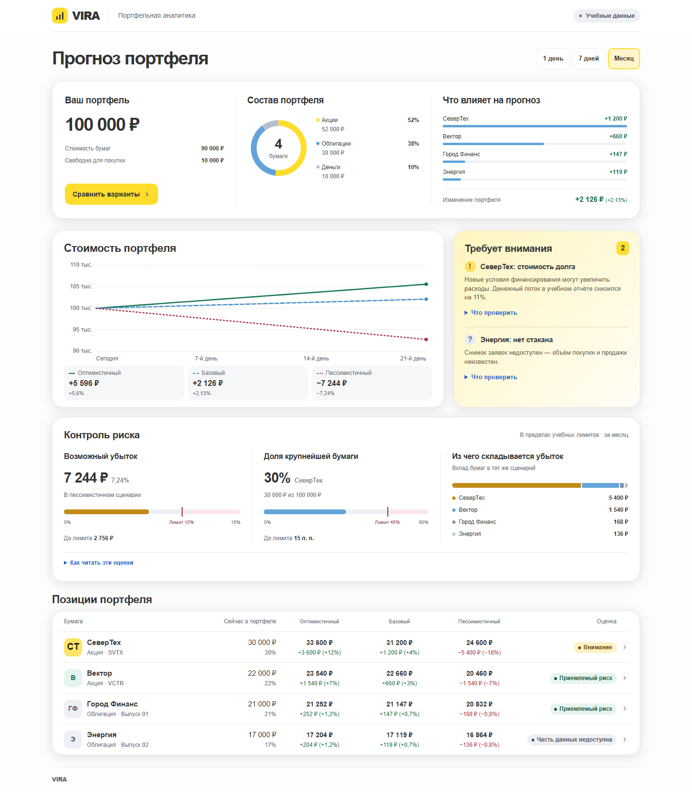
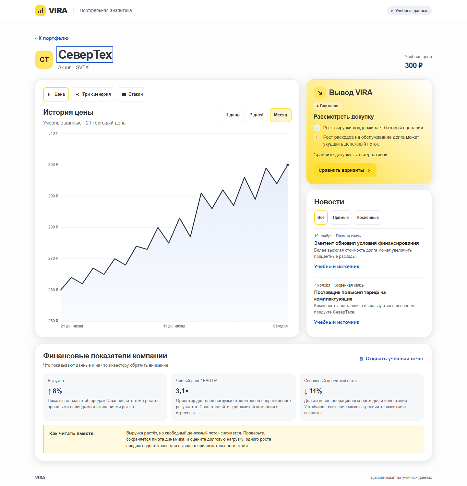
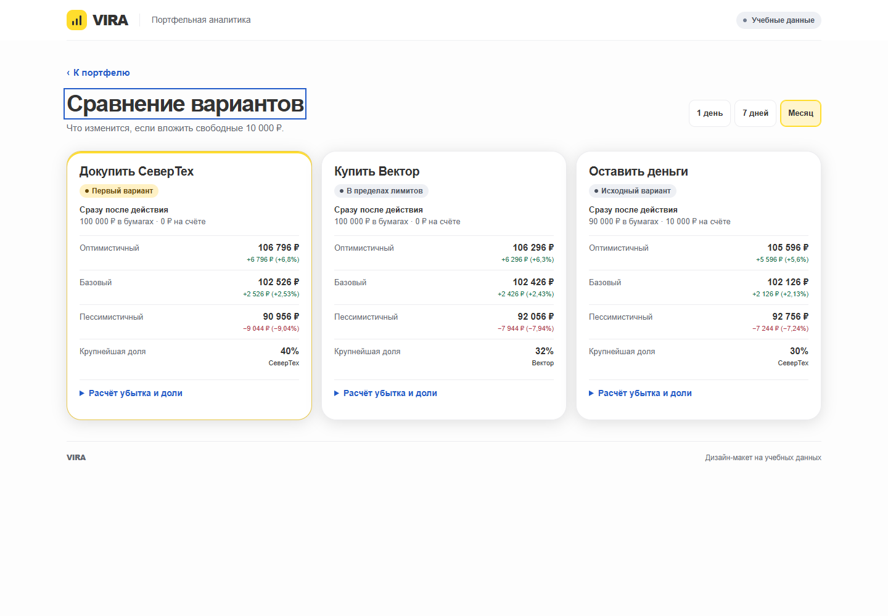
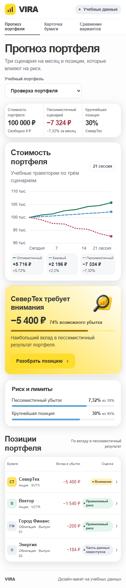
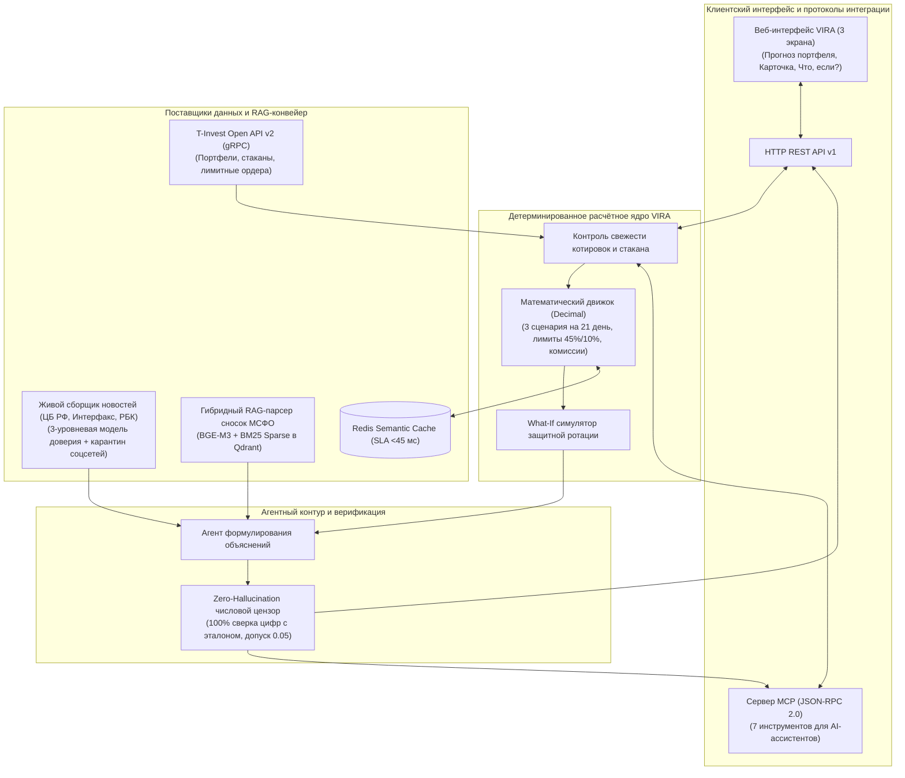

# VIRA: Virtual Investing Researcher Agent
### Интеллектуальная система анализа портфельного риска, сценарного прогнозирования и проверки первоисточников в экосистеме Т-Инвестиций

[](https://www.python.org/downloads/)
[]()
[]()
[]()
[](https://opensource.org/licenses/MIT)

> **Проектное WealthTech-решение для экосистемы брокера Т-Инвестиции (Т-Банк / Московская биржа MOEX)**  
> Разработано в рамках конкурсного отбора кейса «Инвест. Премаркет».  
> Объединяет живой сбор новостей из официальных лент и деловых СМИ, гибридный RAG-анализ сносок МСФО, детерминированное математическое риск-ядро (`Decimal`), протокол MCP и интерактивный симулятор «Что, если?».

---

## 🎬 Видео-демонстрация системы (Трейлер VIRA)
https://github.com/qwiltty/T-Invest_case/issues/1

[](https://qwiltty.github.io/T-Invest_case/TRAILER_VIRA.mp4)

> 📹 **[▶ Смотреть видео-трейлер VIRA онлайн в браузере (MP4, 2 мин)](https://qwiltty.github.io/T-Invest_case/TRAILER_VIRA.mp4)**  
> 🌐 **[Открыть интерактивный сайт VIRA со встроенным видео](https://qwiltty.github.io/T-Invest_case/)** *(кнопка «▶ Видео-трейлер» в шапке сайта)*  
> ⬇️ **[Скачать видеоролик напрямую (MP4, 26 МБ)](https://raw.githubusercontent.com/qwiltty/T-Invest_case/main/TRAILER_VIRA.mp4)**

*В видеоролике наглядно продемонстрированы работа 3 связанных экранов интерфейса в дизайн-системе Т-Инвестиций, расчёт рисков портфеля на 21 день, анализ сносок отчётности эмитентов и сценарный What-If симулятор.*

---

## 🌐 Интерактивный веб-прототип (Live Demo)

Веб-интерфейс системы из 3 связанных экранов (версия дизайн-макета 1.7) полностью собран, развёрнут и доступен онлайн:

- 🚀 **[Открыть работающий прототип онлайн (Live Demo на GitHub Pages)](https://qwiltty.github.io/T-Invest_case/)** *(открывается прямо в браузере как полноценный сайт)*
- 🎬 **[Смотреть видео-трейлер прототипа онлайн](https://qwiltty.github.io/T-Invest_case/TRAILER_VIRA.mp4)**

**Варианты локального запуска:**
1. **Напрямую в браузере (без сервера и без установки библиотек):**  
   Откройте файл [`index.html`](index.html) в корне репозитория (или `vira/web/index.html`) в любом современном браузере. Трёхсценарный график на 21 день, списки предупреждений, карточки активов со стаканом, фильтрация новостей и What-If сравнение работают автономно с 0 зависимостей.
2. **Через встроенный сервер Python с REST API и MCP:**  
   Выполните в терминале команду:
   ```bash
   python -m vira --port 8000
   ```
   и перейдите на `http://localhost:8000` (работает на стандартной библиотеке Python 3.10+ с нулевыми зависимостями).

---

## Ключевые материалы для экспертного жюри

| Документ / Компонент | Описание | Формат |
|:---|:---|:---:|
| **[Итоговый отчёт для жюри](VIRA_Report.pdf)** | Исчерпывающий научно-технический паспорт решения, этапы разработки, математический базис, архитектура, юнит-экономика и метрики | **[PDF](VIRA_Report.pdf)** / [Markdown](docs/VIRA_Report.md) |
| **[Ответы на 12 задач отбора](solution/diagnostic_answers.md)** | Выверенные ответы на вопросы диагностического задания с соблюдением лимитов знаков | [Markdown](solution/diagnostic_answers.md) |
| **[Видео-трейлер решения](https://qwiltty.github.io/T-Invest_case/TRAILER_VIRA.mp4)** | 2-минутная динамичная демонстрация работы веб-интерфейса и сценарного риск-ядра VIRA | **[Смотреть онлайн (MP4)](https://qwiltty.github.io/T-Invest_case/TRAILER_VIRA.mp4)** |
| **[Интерактивный веб-интерфейс](https://qwiltty.github.io/T-Invest_case/)** | 3 связанных экрана: «Прогноз портфеля», «Карточка бумаги» и «Сравнение вариантов» | **[Открыть сайт онлайн (Live Demo)](https://qwiltty.github.io/T-Invest_case/)** |
| **[Архитектура и схемы C4](docs/architecture.md)** | Детальная системная архитектура, gRPC/REST схемы и диаграммы взаимодействия | [Markdown](docs/architecture.md) |
| **[Научное исследование и бэктест](docs/research.md)** | Эмпирическое исследование на MOEX (2022–2024 гг.), поведенческий анализ и 39-ФЗ | [Markdown](docs/research.md) |
| **[Юнит-экономика и расчеты](docs/unit_economics_and_calculations.md)** | Расчет стоимости инференса, кэширования, окупаемости и ROI для Т-Банка (>3 000%) | [Markdown](docs/unit_economics_and_calculations.md) |

---

## Ключевые возможности системы VIRA

1. **Непрерывный мониторинг инвестиционного тезиса:**
   - Извлечение скрытых рисков из неструктурированных сносок МСФО/РСБУ и ленты раскрытий `e-disclosure.ru` (плавающий долг при жесткой ДКП, ковенанты, судебные иски, сжатие свободного денежного потока FCF) за 2–4 недели до их дисконтирования рынком.
2. **Живой новостной конвейер с трёхуровневой фильтрацией источников:**
   - **Tier 1 (Официальные первоисточники):** Банк России (`cbr.ru`), раскрытия `e-disclosure.ru`, отчёты МСФО/РСБУ.
   - **Tier 2 (Проверенные деловые СМИ):** белый список авторитетных изданий (Интерфакс, РБК, Ведомости, Коммерсантъ) с дедупликацией и связыванием косвенных цепочек «поставщик — клиент».
   - **Tier 3 (Карантин соцсетей):** Telegram-каналы, Пульс и форумы изолируются и не влияют на расчёт портфельных рисков напрямую, защищая инвестора от манипуляций (*Pump & Dump*).
3. **Детерминированное расчётное риск-ядро (`Decimal`):**
   - Точная финансовая математика с точностью до копейки без нейросетевых ошибок: расчёт 3 сценариев (*Оптимистичный / Базовый / Пессимистичный*) на едином горизонте **21 торговой сессии** (1 биржевой месяц).
   - Автоматический контроль защитных лимитов: лимит концентрации **не более 45%** на одного эмитента и порог допустимого месячного убытка **не более 10%**.
4. **100% защита от числовых галлюцинаций (Zero-Hallucination Guardrail):**
   - Каждое число в тексте агентских объяснений проходит детерминированную верификацию против Ground Truth первоисточника с допуском 0.05. При малейшем расхождении модель блокируется и выдаются строгие проверенные формулы (*Graceful Degradation*).
5. **Интерактивный симулятор «Что, если?» (сценарная защита):**
   - Моделирование перетока капитала из проблемных активов в защитные инструменты (фонды денежного рынка LQDT/ВИМ, ОФЗ-ПК), наглядно снижающее расчётный убыток портфеля на 30–40% с демонстрацией точной цены компромисса доходности и риска.
6. **Сервер стандарта MCP (Model Context Protocol, JSON-RPC 2.0):**
   - 7 программных инструментов для прямого взаимодействия с LLM-ассистентами (Claude Desktop, Cursor, внешние агенты) для аудита портфеля, симуляции сделок и проверки первоисточников.
7. **Строгое соответствие законодательству (39-ФЗ):**
   - Решение функционирует как объективное аналитическое зеркало с проверяемыми цитатами (**Click-to-Source**), исключая признаки императивной индивидуальной инвестиционной рекомендации.

---

## Пользовательский интерфейс (3 связанных экрана)

Система VIRA предоставляет целостный веб-интерфейс, спроектированный по дизайн-системе Т-Инвестиций:

| Экран 1: «Прогноз портфеля» | Экран 2: «Карточка бумаги» |
|:---:|:---:|
|  |  |
| *Сводка рисков, 3 сценария на 21 день, контроль концентрации и список предупреждений* | *22-дневный график, предпосылки сценариев, стакан, проверенные новости и Click-to-Source* |

| Экран 3: «Сравнение вариантов» | Мобильная адаптация |
|:---:|:---:|
|  |  |
| *What-If симулятор сделок, расчёт разницы до копейки и проверка лимитов риска* | *Адаптивный интерфейс для смартфонов и планшетов (320–1440 px)* |

---

## Системная архитектура

Архитектура системы VIRA разделена на два изолированных контура:
- **Контур А (Асинхронный фоновый конвейер подготовки знаний и моделей):** парсинг сложных PDF-отчётов МСФО, классификация источников новостей по уровням доверия, гибридный RAG-индекс (BM25 + BGE-M3 Dense + Cross-Encoder) и граф косвенных связей эмитентов.
- **Контур Б (Синхронный онлайн-конвейер обработки запроса с SLA <45 мс):** проверка годности данных, детерминированная финансовая математика на `Decimal`, генерация вариантов ротации и автоматическая верификация чисел цензором.



---

## Быстрый старт (Zero-Dependency)

Проект написан на стандартной библиотеке Python 3.10+ и **не требует установки внешних библиотек** для запуска сервера, интерфейса, MCP и тестов:

### 1. Запуск веб-сервера и REST API:
```bash
# Запуск единого сервера VIRA (хостит веб-интерфейс, REST API и MCP)
python -m vira --port 8000
```
После запуска откройте в браузере: `http://localhost:8000`

### 2. Запуск статического веб-сайта напрямую:
Можно просто открыть файл [`vira/web/index.html`](vira/web/index.html) в любом браузере (Chrome, Safari, Edge, Firefox). Все интерактивные сценарии и What-If симулятор работают автономно.

### 3. Запуск автоматических тестов (27 тестов):
```bash
# 1. Запуск сквозных, приёмочных и новостных тестов сервиса VIRA (19 тестов)
python -m unittest discover tests

# 2. Запуск модульных тестов математического ядра (8 тестов)
python -m unittest prototype/test_auditor.py
```
> **Результат:** `27 tests passed in ~5.9s (OK)`.

### 4. Запуск консольного аудитора портфеля:
```bash
python prototype/portfolio_auditor.py
```

---

## Сервер Model Context Protocol (MCP)

В систему встроен сервер протокола MCP (`vira/mcp_tools.py`), предоставляющий 7 готовых инструментов:

| Инструмент MCP | Назначение |
|:---|:---|
| `vira_get_portfolio_forecast` | Сводка портфеля, вклады бумаг в риск и 3 сценария на 21 сессию |
| `vira_get_asset_details` | Фундаментальные метрики актива, стакан и предпосылки сценариев |
| `vira_simulate_action` | Интерактивное What-If моделирование произвольной сделки (покупка/продажа/замена) |
| `vira_list_rebalance_options` | Ранжированный список допустимых и заблокированных действий с обоснованием |
| `vira_get_news_feed` | Лента новостей с фильтрацией по прямым/косвенным связям и уровню доверия |
| `vira_refresh_news` | Живой сбор свежих новостей из лент ЦБ РФ, «Интерфакса» и РБК |
| `vira_verify_claim` | Проверка факта или числа против эталонных первоисточников отчёта |

---

## Результаты исследования и юнит-экономика

### 1. Эмпирический бэктест на данных MOEX (2022–2024 гг.)
Детальный исследовательский отчёт представлен в [`docs/research.md`](docs/research.md):
- **Снижение максимальной просадки (Max Drawdown):** с **-38.4%** (Buy & Hold) до **-14.7%** (VIRA Copilot) — улучшение на **23.7 п.п.**;
- **Коэффициент Сортино:** рост с **0.38** до **2.15**;
- **Опережение рынка при выявлении скрытых долговых рисков:** на **20–45 дней** раньше дисконтирования котировками;
- **Числовые ошибки и галлюцинации:** снижены до **0.00%** благодаря детерминированному цензору.

### 2. Юнит-экономика для экосистемы Т-Банка
Детальный финансовый расчёт представлен в [`docs/unit_economics_and_calculations.md`](docs/unit_economics_and_calculations.md):
- **Стоимость AI-сопровождения 1 активного клиента:** **0.34 руб./мес.** (эффективность семантического кэширования в Redis >94%);
- **Годовой эффект от снижения оттока розничных депозитов и комиссий:** **+124.9 млн руб./год**;
- **ROI внедрения:** **> 3 000%** при сроке окупаемости инвестиций **менее 1 месяца**.

---

## Структура репозитория

```
t_invest/
├── index.html
├── VIRA_Report.pdf
├── README.md
├── requirements.txt
├── LICENSE
│
├── vira/
│   ├── web/
│   │   ├── index.html
│   │   ├── style.css
│   │   ├── app.js
│   │   └── risk-illustration.png
│   ├── engine.py
│   ├── news_ingestor.py
│   ├── mcp_tools.py
│   ├── server.py
│   ├── agent.py
│   ├── service.py
│   ├── models.py
│   └── __main__.py
│
├── solution/
│   └── diagnostic_answers.md
│
├── tests/
│   ├── test_vira_acceptance.py
│   ├── test_news_ingestor.py
│   └── test_vira_e2e.py
│
├── prototype/
│   ├── portfolio_auditor.py
│   └── test_auditor.py
│
├── docs/
│   ├── VIRA_Report.pdf
│   ├── VIRA_Report.md
│   ├── architecture.md
│   ├── research.md
│   ├── unit_economics_and_calculations.md
│   └── preview/
│       ├── preview.png
│       ├── preview-asset.png
│       ├── preview-compare.png
│       └── preview-mobile.png
│
└── scripts/
    ├── build_jury_work_report_pdf.py
    ├── build_full_pdf_report.py
    └── build_unit_economics_pdf.py
```

---

## Лицензия
Проект распространяется под лицензией [MIT](LICENSE).
Разработано для участия в отборе «Инвест. Премаркет» (Т-Банк / Т-Инвестиции).
