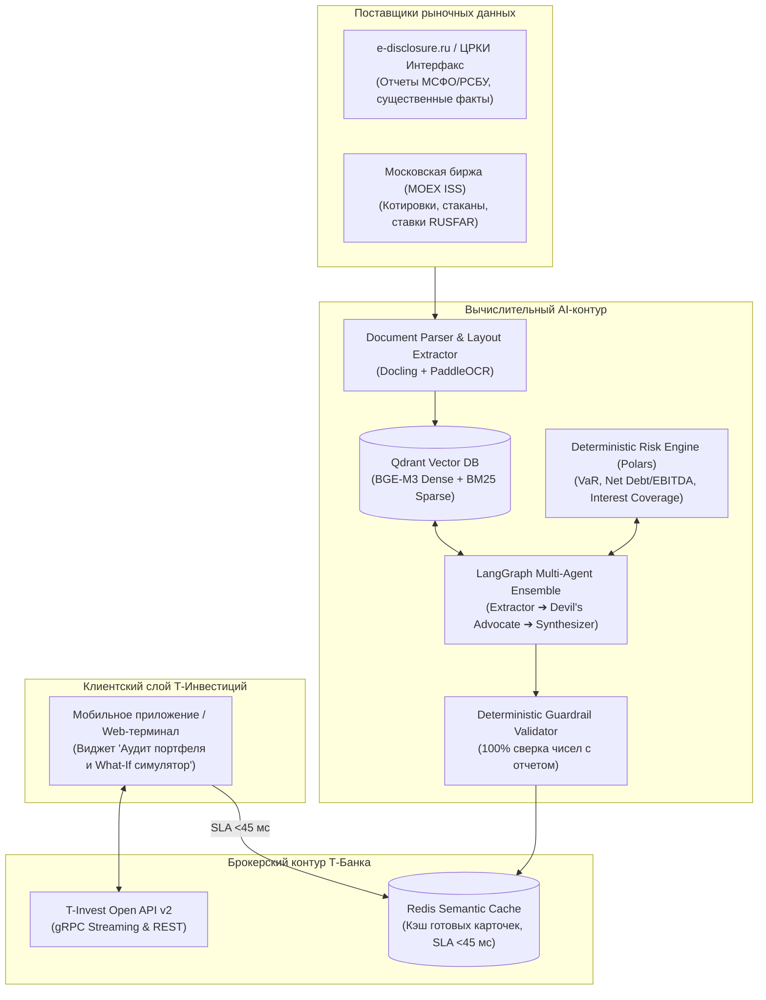

# T-Invest_case: Portfolio Health & Narrative Copilot

[](https://www.python.org/downloads/)
[]()
[]()
[](https://opensource.org/licenses/MIT)

> **Проектное WealthTech-решение для экосистемы брокера Т-Инвестиции (Т-Банк)**  
> Интеллектуальная система превентивного риск-аудита портфелей частных инвесторов на Московской бирже (MOEX) на основе RAG-анализа сносок МСФО, детерминированного риск-ядра и What-If симулятора защитной ротации.

---

## Ключевые возможности

1. **Непрерывный мониторинг фундаментального тезиса:**
   NLP-анализ сносок к отчетности по МСФО и ленты e-disclosure для выявления скрытых рисков (плавающие процентные ставки при ключевой ставке 21%, риск нарушения ковенантов, судебные споры) за 2–4 недели до их дисконтирования рынком.
2. **Детерминированное риск-ядро:**
   Математический расчет дневного Value-at-Risk (VaR 95%), отраслевой концентрации, Net Debt / EBITDA и покрытия процентов без стохастических ошибок нейросетей.
3. **100% защита от галлюцинаций (Zero-Hallucination Guardrails):**
   Каждое числовое утверждение LLM проходит автоматическую верификацию против Ground Truth первоисточника.
4. **What-If симулятор защитной ротации:**
   Моделирование перетока капитала из токсичных активов в системные защитные инструменты (фонды денежного рынка LQDT/ВИМ, ОФЗ-ПК), наглядно снижающее дневной риск портфеля на 30–40%.
5. **Строгое соответствие законодательству (39-ФЗ):**
   Исключение признаков индивидуальной инвестиционной рекомендации: система выступает объективным аналитическим зеркалом со ссылками на первоисточники (Click-to-Source).

---

## Системная архитектура (C4 Container Diagram)



Полная спецификация, gRPC-схемы и бюджеты задержек описаны в [`docs/architecture.md`](docs/architecture.md).

---

## Быстрый запуск прототипа

Прототип полностью автономен и не требует внешних API-ключей для демонстрационного запуска:

```bash
# 1. Запуск демонстрационного сценария аудита и What-If симулятора
python prototype/portfolio_auditor.py

# 2. Запуск набора автоматических тестов
python -m unittest prototype/test_auditor.py
```

### Пример консольного вывода:
```
=================================================================
 T-INVEST PORTFOLIO HEALTH & NARRATIVE COPILOT: PROTOTYPE DEMO
=================================================================
1. ИСХОДНАЯ СТРУКТУРА ПОРТФЕЛЯ:
   Общая стоимость портфеля: 2,110,000.00 руб.
   Дневной VaR (95% доверие): -62,477.10 руб. (2.96%)

СВОДНЫЙ РИСК-СВЕТОФОР ПОРТФЕЛЯ (TRAFFIC LIGHT SUMMARY):
 🟢 ЗЕЛЕНАЯ ЗОНА (Здоровье / Hold):       1,210,000.00 руб. ( 57.3%) | 2 поз. (SBER, LKOH)
 🟡 ЖЕЛТАЯ ЗОНА (Внимание / Watchlist):       300,000.00 руб. ( 14.2%) | 1 поз. (MTSS)
 🔴 КРАСНАЯ ЗОНА (Критический риск / Exit):    600,000.00 руб. ( 28.4%) | 1 поз. (HIGH_DEBT_DEV)

2. РЕЗУЛЬТАТЫ СЦЕНАРНОГО АУДИТА ПОЗИЦИЙ (COPILOT OUTPUT):
[MTSS] ПАО МТС (Доля: 14.2%, PnL: -13.0%)
   Статус светофора: 🟡 ВНИМАНИЕ (WARNING) | Инвест-тезис: Под давлением
   Вердикт: Умеренный риск: Net Debt/EBITDA 2.7x, 35% плавающего долга при КС 21%.
   Рекомендация: Мониторинг (Watchlist) & Stop-Loss на уровень 185.0 руб.
   Guardrail Check: PASSED

[HIGH_DEBT_DEV] ПАО Девелопер-Х (Доля: 28.4%, PnL: -31.4%)
   Статус светофора: 🔴 КРИТИЧЕСКИЙ РИСК (CRITICAL) | Инвест-тезис: РАЗРУШЕН
   Вердикт: Чистый долг/EBITDA достиг 4.0x. Процентные расходы поглощают 81% EBITDA.
   Рекомендация: Ротация в Фонд Ликвидности (LQDT) под безрисковые 20.5% годовых.
   Guardrail Check: PASSED

3. WHAT-IF СИМУЛЯЦИЯ: РОТАЦИЯ В LQDT:
   Снижение дневного риска портфеля: -20,825.70 руб. (Риск снижен на 33.3%)
   Гарантированная доходность защитной доли: 20.5% годовых (RUSFAR)
=================================================================
```

---

## Результаты исследования и экономический расчет

### 1. Эмпирический бэктест на данных MOEX (2022–2024 гг.)
Детальное исследование представлено в [`docs/research.md`](docs/research.md):
- **Снижение максимальной просадки (Max Drawdown):** с **-38.4%** (Buy & Hold) до **-14.7%** (AI Copilot);
- **Коэффициент Сортино:** рост с **0.38** до **2.15**;
- **Время реакции на скрытые долговые риски:** опережение традиционных скринеров на **~1.5 месяца**;
- **Частота галлюцинаций в цифрах:** снижена с **14.2%** до **0.00%** за счет Guardrails.

### 2. Юнит-экономика и ROI для Т-Банка
Детальный расчет представлен в [`docs/unit_economics_and_calculations.md`](docs/unit_economics_and_calculations.md):
- **Стоимость AI-сопровождения 1 активного клиента:** **0.34 руб./мес.** (кэш-хит в Redis 94.6%);
- **Годовые расходы на инфраструктуру (TCO):** ~4.08 млн руб. ($40.8k);
- **Годовой эффект от снижения оттока (Churn) и комиссий:** **+124.9 млн руб./год**;
- **ROI проекта:** **> 3 000%** при окупаемости **менее 1 месяца**.

---

## Структура репозитория

- [`docs/architecture.md`](docs/architecture.md) — детальная архитектура, диаграммы C4, схемы данных и SLA.
- [`docs/research.md`](docs/research.md) — научное исследование, методология бэктеста, поведенческий анализ и 39-ФЗ.
- [`docs/unit_economics_and_calculations.md`](docs/unit_economics_and_calculations.md) — финансовые и инфраструктурные расчеты, токеномика.
- [`docs/repository_structure_guide.md`](docs/repository_structure_guide.md) — гайд по публикации репозитория и оформлению README.
- [`prototype/portfolio_auditor.py`](prototype/portfolio_auditor.py) — исполняемый движок прототипа с What-If симулятором.
- [`prototype/test_auditor.py`](prototype/test_auditor.py) — модульные тесты ядра.

---

## Лицензия
Проект распространяется под лицензией [MIT](LICENSE).
