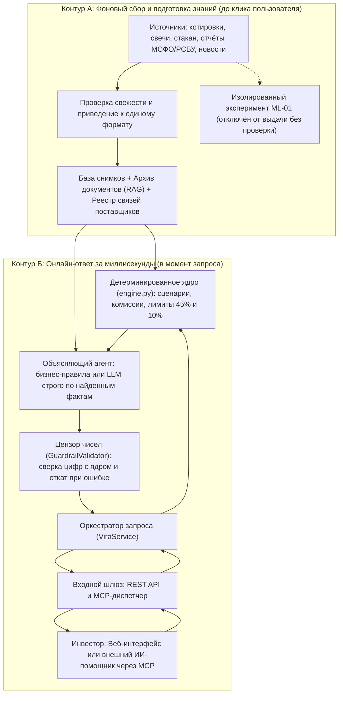
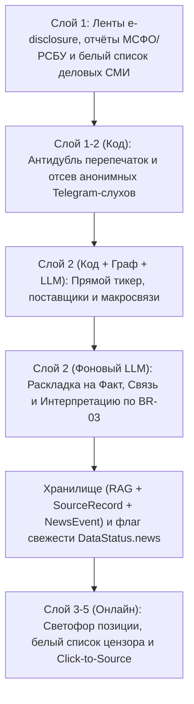

# VIRA: Подробный отчёт об архитектуре и принципах работы системы

**VIRA (Virtual Investing Researcher Agent)** — это умный аналитический помощник для частного инвестора в приложении Т-Инвестиции (кейс «Инвест. Премаркет»).  
Если говорить совсем просто: VIRA помогает человеку **не ошибиться перед сделкой** — увидеть реальные риски всего портфеля целиком, отделить подтверждённые факты от слухов в соцсетях и заранее сравнить варианты действий простым языком с проверяемыми цифрами.

Настоящий отчёт шаг за шагом раскрывает, **зачем** устроена система именно так, **как** работают вместе математика, данные рынка и искусственный интеллект и **как** это уже проверено в учебном веб-прототипе [`vira/`](../vira/README.md).

---

## Содержание отчёта (6 шагов)

1. **[Шаг 1. Постановка проблемы: зачем нужна VIRA, что сломано сейчас и на чём строится решение](#шаг-1-постановка-проблемы-зачем-нужна-vira-что-сломано-сейчас-и-на-чём-строится-решение)** *(готово)*
2. **[Шаг 2. Общая архитектура системы: как устроены 5 слоёв VIRA и путь одного запроса](#шаг-2-общая-архитектура-системы-как-устроены-5-слоёв-vira-и-путь-одного-запроса)** *(готово)*
3. **[Шаг 3. Математическое ядро: как код без единой ошибки считает сценарии, доли, дивиденды и лимиты риска](#шаг-3-математическое-ядро-как-код-без-единой-ошибки-считает-сценарии-доли-дивиденды-и-лимиты-риска)** *(готово)*
4. **[Шаг 4. Откуда берутся знания: рыночные данные, поиск по отчётам (RAG), граф связей и эксперимент `ML-01`](#шаг-4-откуда-берутся-знания-рыночные-данные-поиск-по-отчётам-rag-граф-связей-и-эксперимент-ml-01)** *(готово)*
5. **[Шаг 5. Искусственный интеллект под контролем: защита от выдумок, честная пауза при нехватке данных и закон 39-ФЗ](#шаг-5-искусственный-интеллект-под-контролем-защита-от-выдумок-честная-пауза-при-нехватке-данных-и-закон-39-фз)** *(готово)*
6. **[Шаг 6. Интерфейс, интеграция (REST API и протокол MCP) и как мы проверяем качество](#шаг-6-интерфейс-интеграция-rest-api-и-протокол-mcp-и-как-мы-проверяем-качество)** *(готово)*

---

## Шаг 1. Постановка проблемы: зачем нужна VIRA, что сломано сейчас и на чём строится решение

### 1.1. О ком и о какой жизненной ситуации мы говорим

Представьте обычного частного инвестора, который уже собрал свой небольшой портфель в Т-Инвестициях — скажем, на `100 000 ₽` — из акций и облигаций (в проектной документации такой профиль целевого пользователя обозначен кодом `Q-01a` в [Стартовом протоколе](../vira_materials/VIRA-01-Стартовый-протокол.md)). Это не биржевой спекулянт, торгующий каждую секунду, а человек, который заходит в портфель раз в неделю или когда видит тревожные новости.

В реальной жизни у него регулярно возникают **три конкретные задачи** *(в документации по бизнес-анализу эти типовые пользовательские сценарии сокращённо называются `UC` — от англ. Use Case; см. [Бизнес-анализ](../vira_materials/VIRA-02-Бизнес-анализ.md))*:

1. **Ситуация 1 — «Портфель уже полностью в бумагах, свободных денег нет (`0 ₽`), а одна из акций начала пугать»** *(главный путь системы, в документации — `UC-03`)*
   * **О чём думает человек:** *«У меня все `100 000 ₽` уже распределены по портфелю, свободного кэша нет. По одной компании выходят тревожные новости. Как сильно весь мой портфель может просесть за ближайший месяц? Какая именно бумага тянет его вниз? Что мне разумнее сделать — переждать, продать её в рубли или сразу переложить вырученные деньги в другую, более спокойную бумагу?»*

2. **Ситуация 2 — «Появились свободные деньги (например, `10 000 ₽`), куда их лучше направить?»** *(второй путь, в документации — `UC-01`)*
   * **О чём думает человек:** *«Пришла зарплата или купоны, на счёте лежат свободные `10 000 ₽`. Что безопаснее и выгоднее на ближайший месяц: вообще оставить их в рублях, докупить уже знакомую бумагу или взять другую? И как это изменит риск не только одной покупки, но и всего моего портфеля?»*

3. **Ситуация 3 — «Хочу заглянуть внутрь компании и понять, откуда взялся вывод»** *(углублённый разбор бумаги, в документации — `UC-02`)*
   * **О чём думает человек:** *«Хорошо, система говорит, что акция рискованная. Но почему я должен ей верить? Покажите простым языком аргументы "за" и "против", финансовые цифры компании, что именно случилось в новостях и дайте ссылку на официальный документ, где я сам это проверю».*

> **Единая «линейка» сравнения (`Q-01b`):** во всех трёх ситуациях VIRA сравнивает варианты на одном понятном горизонте — **21 торговая сессия** (около 1 рабочего месяца на бирже) — и всегда честно показывает **две стороны выбора**: сколько можно заработать в хорошем и обычном развитии событий и сколько можно потерять в плохом.

---

### 1.2. Что именно не работает сегодня (AS-IS): 5 главных проблем от житейской логики до уровня финансов и AI

Когда человек пытается ответить на эти вопросы без специальной системы (через обычный график котировок, брокерские скринеры, Telegram-каналы или универсальный чат с нейросетью), он упирается в пять системных ловушек.

#### Проблема 1. «Хорошая бумага сама по себе» может сломать весь портфель
* **Объяснение на пальцах:** В обычном магазине выбор прост: если одна куртка лучше другой — бери её. В инвестициях так не работает: даже если компания отличная и надёжная, вложить в неё больше половины всех своих денег опасно — любое случайное событие в одной отрасли ударит по всему вашему капиталу. Человек привык оценивать акции поодиночке («акция Б спокойнее, чем акция А — переложу всё в Б») и не замечает, как создаёт опасный перекос.
* **Что происходит в числах (контрольный пример VIRA и теория портфеля):**
  Ещё в 1952 году Гарри Марковиц показал *(источник `E-03` в [Кабинетном исследовании](../vira_materials/VIRA-01-Кабинетное-исследование.md))*, что итоговый риск инвестора зависит не столько от каждой бумаги по отдельности, сколько от **долей (весов) всех бумаг в портфеле целиком**.
  Возьмём эталонный учебный портфель на `100 000 ₽` без свободных денег ([educational_cases.json](../vira/data/educational_cases.json#L295-L314)):
  - `30 000 ₽` (`30%`) — акция `А` («СеверТех»), высокая просадка в плохом сценарии (`−18%`, то есть `−5 400 ₽`);
  - `22 000 ₽` (`22%`) — более устойчивая акция `Б` («Вектор»), просадка в плохом сценарии умеренная (`−7%`, то есть `−1 540 ₽`);
  - `25 000 ₽` (`25%`) — облигация `O1` («Город Финанс», просадка `−0,8%`, то есть `−200 ₽`);
  - `23 000 ₽` (`23%`) — облигация `O2` («Энергия», просадка `−0,8%`, то есть `−184 ₽`).
  Сейчас общий пессимистичный убыток всего портфеля за месяц составляет **`−7 324 ₽`**, и главный виновник — акция `А` (`−5 400 ₽`). Логичная человеческая идея — *«продать проблемную А на `30 000 ₽` и переложить всё в надёжную Б»* — действительно уменьшает возможный убыток почти вдвое: с `−7 324 ₽` до **`−4 024 ₽`**.  
  **Но вот скрытая ловушка:** после такой замены в бумаге `Б` оказывается уже `22 000 + 30 000 = 52 000 ₽`, то есть **доля одной компании вырастает до `52%` портфеля** — выше допустимого порога концентрации `45%`! Без автоматического пересчёта портфеля целиком инвестор видит только снижение убытка и не замечает, что поменял один риск на другой.

#### Проблема 2. Самые важные риски спрятаны в мелком шрифте примечаний к отчётам
* **Объяснение на пальцах:** В короткой карточке приложения видно то, что уже случилось вчера: «выручка выросла». Но проблемы, из-за которых акция падает в ближайшие недели, часто описаны не в таблицах, а в скучных текстовых сносках внутри 50–100-страничных отчётов компаний. Читать всё это вручную перед каждой проверкой портфеля обычному человеку просто некогда (именно поиск и проверка текстовых деталей отняли больше всего времени в реальном эпизоде из практики владельца продукта — `INT-01`).
* **Профессиональная суть:** На российском рынке публичные компании раскрывают отчётность по **МСФО / РСБУ** и публикуют официальные сообщения в **лентах корпоративного раскрытия (`e-disclosure`)**. В нашем контрольном примере по «СеверТеху» выручка формально растёт (`↑ 8%`), но в тексте сносок и раскрытий зашиты два критических сигнала:
  1. при уже высокой долговой нагрузке (`Чистый долг / EBITDA = 3,1×`) часть долга переводится на **плавающую процентную ставку** — значит, при дорогом кредитовании проценты начнут съедать прибыль;
  2. **свободный денежный поток (`FCF` — реальные деньги, которые остаются у компании после всех трат на бизнес и развитие)** уже упал на `11%`.
  Никакой простой фильтр по мультипликаторам из скринера эти текстовые оговорки не улавливает.

#### Проблема 3. Информационный шум и невидимые связи между компаниями («эффект домино»)
* **Объяснение на пальцах:** Не имея времени читать первоисточники, люди идут в Telegram-каналы и социальные сети. Там вперемешку идут официальные факты, слухи «по всей отрасли» и чьи-то эмоции. А иногда важная новость выходит вообще **не про вашу компанию** — например, поднял цены её поставщик комплектующих. Человеку трудно понять: это проверенный факт, логическая цепочка через поставщика или просто пустая паника?
* **Что подтверждают исследования:**
  - По опросу **НАФИ для Банка России** (`E-01`, выборка `2 023` частных инвестора из городов-миллионников), **`37%` инвесторов называют Telegram и соцсети источниками для своих решений**.
  - Работа исследователей **ВШЭ (2026)** на данных Московской биржи (MOEX) за 2015–2024 гг. (`E-05`) показала, что новостной сентимент действительно статистически связан с объёмами торгов и доходностью (особенно в бумагах средней и малой капитализации).
  - Исследование **Cohen & Frazzini (`E-06`)** доказало эффект связки **«поставщик — клиент»**: когда у поставщика меняются цены или условия, рынок с задержкой переносит это на результаты компании-покупателя.
  Поэтому полезный помощник обязан не просто пересказывать заголовки, а жёстко разделять: **(1) сам факт**, **(2) доказанную связь с бумагой** (прямую или через поставщика по документам) и **(3) объяснение последствий** — со ссылкой на первоисточник с датой.

#### Проблема 4. Эмоции и отсутствие честной цены спокойствия
* **Объяснение на пальцах:** Психология мешает инвестору дважды. Во-первых, люди массово покупают те акции, которые «громче всех кричат» в новостях и резко двигаются на бирже (в науке это называется **эффектом внимания**, работа Barber & Odean, `E-02`). Во-вторых, когда купленная акция уже в минусе, человеку психологически тяжело признать ошибку и продать её — он держит убыток в надежде «хотя бы вернуться в ноль» (в поведенческих финансах — **эффект диспозиции, Disposition Effect**). И наоборот, когда человек решает «уйти в тихие деньги», он редко видит на одном экране, от какой потенциальной прибыли в хорошем месяце при этом отказывается.
* **Профессиональная суть:** Система не должна подталкивать к импульсивным сделкам; вместо «кнопки купить по хайпу» она должна показывать полный коридор исходов (`пессимистичный / базовый / оптимистичный`) и явную **цену компромисса** между снижением риска и сохранением потенциала роста.

#### Проблема 5. Почему нельзя просто «подключить ChatGPT к портфелю и бирже»
* **Объяснение на пальцах:** Возникает соблазн: *«А давайте отдадим большой языковой нейросети (LLM) портфель, таблицы котировок и новости — пусть она сама всё посчитает и напишет, что делать»*. В реальных инвестициях такой наивный подход ломается сразу в четырёх местах:
  1. **Нейросеть не калькулятор — она ошибается в арифметике и терминах.** LLM предсказывает слова по смыслу, поэтому может незаметно округлить `−4 024 ₽` в `−4 000 ₽`, перепутать доходность акции за месяц с ростом выручки самой компании (`E-04`, Novy-Marx) или забыть учесть брокерскую комиссию, дивиденды по акциям и купоны по облигациям (`Q-02`).
  2. **Обычный чат-бот не умеет честно останавливаться.** Если по неликвидной облигации сегодня нет биржевого стакана (очереди реальных заявок на покупку и продажу) или котировки устарели на три дня, обычная LLM склонна «додумать» уверенный ответ вместо того, чтобы предупредить о пробеле в данных.
  3. **Нельзя смешивать в одной текстовой каше биржевой стакан, графики свечей и новости.** Стакан и свечи цены — это строгая математика (спред, объём ликвидности, волатильность), а не литература. Если «скармливать» нейросети сырые таблицы цен, она начнёт выдумывать несуществующие закономерности.
  4. **Регуляторные требования (`39-ФЗ` и правила Банка России).** Безапелляционный совет вида *«Срочно продай А и купи Б»* без оценки профиля инвестора (включая статус квалифицированного или неквалифицированного инвестора), раскрытия рисков и дисклеймеров создаёт прямые юридические риски незаконного индивидуального инвестиционного консультирования (ИИР).

---

### 1.3. Научная честность: что доказано уже сейчас, а что остаётся проверяемой гипотезой

Чтобы архитектура VIRA не строилась на самообмане («волшебный ИИ предскажет курс акций»), мы с первого шага делим все утверждения на три строгие категории:

| Уровень уверенности | Что сюда относится простым языком | Детали и статус |
|---|---|---|
| **1. Подтверждённые факты и научная база** | То, что уже доказано статистикой, опросами и независимыми академическими работами, на которые мы опираемся. | • `37%` инвесторов читают Telegram/соцсети для решений (`E-01`, НАФИ/ЦБ РФ, `2 023` респондента). • Розница смещает покупки к шумным/волатильным бумагам (`E-02`, Barber & Odean). • Риск нужно считать по весам всего портфеля (`E-03`, Markowitz). • Новостной тон влияет на торги на MOEX (`E-05`, ВШЭ 2026) и передаётся по цепочкам поставщиков (`E-06`, Cohen & Frazzini). • Красивые модели доходности на прошлом часто ломаются в будущем (`E-07`, Goyal–Welch–Zafirov 2024). |
| **2. Продуктовые гипотезы команды (`H-01`–`H-04`)** | Наши предположения о том, что интерфейс и формат объяснений действительно удобны людям — их нужно проверять на реальных пользователях. | Удобство сравнения вариантов на `21` сессии, экономия времени на проверке рисков за счёт разделения «факт / связь / вывод», полезность персонального ориентира доходности (`H-04`). |
| **3. Изолированный ML-эксперимент (`ML-01`)** | Попытка научить классическую табличную модель машинного обучения оценивать диапазон будущих цен по дневным графикам свечей (**OHLCV** — цена открытия, максимум, минимум, закрытие и объём торгов за день). | Модель должна выдавать три вероятностных порога (**квантили `P10 / P50 / P90`** — пессимистичный, базовый и оптимистичный ориентир) и проходить строгий «экзамен на новом времени» (**walk-forward проверка**, где модель тестируют только на тех датах, которых она не видела при обучении) против примитивного прогноза `0%` и скользящих исторических границ. **Жёсткое правило:** пока `ML-01` не докажет пользу на этом экзамене, в живой продукт и к инвестору он **не допускается**. |

---

### 1.4. Как мы это решаем (TO-BE): 5 железных принципов архитектуры VIRA

Чтобы устранить все пять проблем из раздела 1.2 и не допустить галлюцинаций, вся система строится на пяти обязательных правилах:

1. **Строгое разделение труда: «Калькулятор отдельно, читатель отдельно, эксперимент отдельно»**
   - **Детерминированный код ([engine.py](../vira/engine.py) и [models.py](../vira/models.py)) — «бухгалтер и риск-менеджер»:** считает стоимость портфеля, сценарии на `21` сессию, комиссии брокера, будущие дивиденды и купоны (`Q-02`), доли позиций, спред/глубину стакана и пороги риска (`45%` концентрации и `10%` пессимистичного убытка). Вся денежная математика работает на точном десятичном типе `Decimal` с банковским/коммерческим округлением `ROUND_HALF_UP` до копеек, чтобы не терялись даже рублёвые доли.
   - **Табличный ML (`ML-01`) — «отдельная лаборатория»:** работает только по дневным свечам OHLCV в исследовательском контуре и не подмешивается в рабочие расчёты без доказанного качества.
   - **AI-агент (LLM + поиск по отчётам RAG) — «аналитик-переводчик»:** читает неструктурированный текст (отчёты МСФО, ленту раскрытий, новости), выделяет аргументы «за» и «против», объясняет косвенные связи через поставщиков и формулирует человеческий вывод и *условие пересмотра* поверх уже готовых точных цифр. **Считать деньги нейросети запрещено.**

2. **Прозрачность и проверка в один клик (`Click-to-Source`, требования `BR-03`, `AC-03.2`, `AC-03.5`)**
   Любой текстовый аргумент в карточке бумаги жёстко раскладывается на три понятных блока:
   - *Факт* (что именно произошло по документу);
   - *Подтверждённая связь с бумагой* (прямое раскрытие эмитента или доказанная цепочка через поставщика);
   - *Интерпретация* (почему это важно для риска позиции).
   Рядом всегда есть ссылка на датированный первоисточник, а в общем обзоре портфеля можно раскрыть расчёт и увидеть вклад каждой бумаги в рублях и процентах.

3. **Автоматический «цензор против галлюцинаций» (`Guardrail-first`, класс [`GuardrailValidator`](../vira/agent.py#L53))**
   Даже когда текстовый агент (или подключённая LLM) формулирует ответ живым языком, перед показом пользователю текст перехватывает детерминированный контролёр. Он извлекает **все числа** из сгенерированного текста (рубли, проценты, доли, мультипликаторы) и сверяет их с числами расчётного ядра и первоисточников. Если обнаружено хотя бы одно придуманное или искажённое число — текст LLM немедленно отбрасывается, а пользователь получает гарантированно точное объяснение по выверенным бизнес-правилам.

4. **Честная пауза при нехватке или устаревании данных (`AC-03.4`, `FR-04`, `Q-04d`)**
   VIRA различает два типа пробелов (оба уже смоделированы в учебном наборе [educational_cases.json](../vira/data/educational_cases.json)):
   - *Локальный пробел — нет только биржевого стакана* (как у облигации `O2` «Энергия»): портфельный пересчёт и сценарии **продолжают работать**, но карточка прямо предупреждает: перед реальной сделкой ликвидность по стакану нужно проверить отдельно.
   - *Критический пробел — устарели котировки или пропала отчётность* (сценарий `partial_data`): система **блокирует выдачу активного совета** («Недостаточно данных для вывода»), показывает точный список недостающих сведений, при этом честно оставляет доступную часть расчётов и **всегда предупреждает, если лимит риска по портфелю уже нарушен**.

5. **Инвестор остаётся у руля + чёткие границы того, чего VIRA НЕ делает (`Q-01b`, `39-ФЗ`)**
   - VIRA **не** выставляет заявки на биржу автоматически и **не** принимает решения вместо человека.
   - VIRA **не** прячет недостатки даже у лучшего по рейтингу варианта — пользователь всегда видит компромисс (например, потерю потенциальной прибыли в кэше или риск превышения концентрации `52% > 45%` при замене).
   - VIRA **не** даёт слепых персональных команд «купи/продай» в обход правил `39-ФЗ`: она выдаёт структурированный сценарный расчёт на едином горизонте `21` сессии и условия, при которых вывод нужно пересмотреть.

---

### 1.5. Как проблемы Шага 1 напрямую задают следующие шаги архитектуры

| Проблема инвестора (из Шага 1) | Что именно мы спроектируем для её решения дальше |
|---|---|
| Замена «плохой» акции ломает весь портфель (`52%` вместо `45%`) | **Шаг 2 и Шаг 3:** Единая архитектура контуров и детерминированное ядро пересчёта портфеля до и после сделки в [engine.py](../vira/engine.py). |
| Риски в сносках МСФО и шум в Telegram | **Шаг 4:** Конвейер сбора официальных раскрытий и новостей, гибридный поиск (RAG) по документам и фиксация косвенных связей с датой и цитатой. |
| Смешение стакана, свечей цены и новостей в одной LLM | **Шаг 2 и Шаг 4:** Математическая агрегация стакана/свечей кодом + изоляция прогноза цены в отдельный walk-forward эксперимент `ML-01`. |
| Выдумки цифр и нехватка котировок/отчётности | **Шаг 5:** Контур контроля свежести данных, строгая матрица допустимых вердиктов (`Q-04b`–`Q-04e`) и [`GuardrailValidator`](../vira/agent.py#L53) с откатом на точный шаблон. |
| Как всё это превратить в реальный продукт | **Шаг 6:** API, интеграция по протоколу MCP (`Q-05a`), веб-интерфейс и набор автоматических тестов приёмки. |

---

## Шаг 2. Общая архитектура системы: как устроены 5 слоёв VIRA и путь одного запроса

Если в Шаге 1 мы ответили на вопрос **«зачем нужна система и от каких ошибок она спасает»**, то в Шаге 2 разберём **«как именно она устроена изнутри, чтобы работать быстро, честно и без выдумок»**.

---

### 2.1. Главная идея конструкции: разделение на «заготовку заранее» и «быстрый расчёт в моменте»

Представьте хорошо устроенную кухню ресторана:
* Если повар начнёт **при вас** ездить на рынок за овощами, чистить картошку и три часа варить бульон — вы уйдёте голодным.
* Поэтому вся тяжёлая работа делается **заранее на заготовке**, а когда гость садится за стол, блюдо собирается, проверяется и подаётся за секунды.

В программной архитектуре VIRA устроена точно так же — она разделена на **два разных по скорости контура**:

1. **Контур А (Фоновый контур — «подготовка знаний заранее, до клика человека»)**  
   Работает непрерывно в фоне без участия пользователя. Именно здесь система забирает длинные отчёты компаний (по 50–100 страниц PDF), ленты корпоративных раскрытий, новости, биржевые свечи и параметры бумаг, чистит их, проверяет даты свежести и складывает в удобную структурированную библиотеку (факты, ссылки, подтверждённые связи между поставщиками и клиентами).  
   Здесь же, строго отдельно от живого пользователя, живёт исследовательская лаборатория прогнозирования `ML-01`.

2. **Контур Б (Онлайн-контур — «ответ за доли секунды по готовым данным»)**  
   Включается в момент, когда инвестор нажимает кнопку в интерфейсе. Онлайн-контур **никогда не ждёт скачивания 100-страничного отчёта и не считает сложную статистику с нуля**. Он берёт актуальный снимок портфеля, моментально прогоняет детерминированную математику, прикладывает уже найденные факты по компании, при необходимости просит языковую модель сформулировать понятное объяснение, прогоняет текст через автоматического «цензора цифр» и отдаёт готовый проверенный ответ.

> **Почему это критически важно:** разделение контуров решает сразу две проблемы — пользователь не ждёт ответа десятки секунд (предсказуемое время отклика), а искусственный интеллект не «угадывает на ходу», потому что получает уже проверенные цифры и ссылки.

---

### 2.2. Из каких 5 слоёв состоит VIRA (сверху вниз — от биржи до экрана)

Всю систему удобно представить как пять аккуратных этажей. Каждый этаж решает строго свою задачу и общается с соседями по чётким правилам — поэтому любую часть можно дорабатывать или заменять, не ломая остальную систему.

#### Слой 1. Вход данных с рынка и портфеля (Data Ingestion)
* **Простым языком:** «глаза и уши» системы, которые собирают две совершенно разные категории сведений — *сухие рыночные цифры* и *человеческие тексты*.
* **Что именно сюда попадает (в полной архитектуре на российском рынке):**
  1. *Позиции и деньги клиента* (через **Т-Инвестиции Open API v2**): сколько и каких бумаг куплено, сколько свободных рублей лежит на счёте, какая действует комиссия брокера.
  2. *Биржевые цифры (MOEX / СПБ Биржа):* текущая цена, дневные свечи торгов (`OHLCV` — открытие, максимум, минимум, закрытие, объём), биржевой стакан заявок (очередь реальных покупателей и продавцов — спред и глубина ликвидности), а также календарь ближайших дивидендов и купонов.
  3. *Документы и новости:* официальная отчётность по **МСФО / РСБУ**, сообщения из **ленты корпоративного раскрытия (`e-disclosure`)** и оперативные новости из **проверенных деловых СМИ** (белый список: Интерфакс, РБК, Коммерсантъ, Ведомости, ТАСС, ПРАЙМ — с отсечением анонимных слухов из Telegram).
* **Как реализовано в учебном прототипе прямо сейчас:** вместо нестабильных внешних лент используется проверяемый машиночитаемый снимок в [educational_cases.json](../vira/data/educational_cases.json), который загружается функцией [`load_dataset`](../vira/engine.py#L49). При этом в данные намеренно заложены «боевые» поломки из реальной жизни: у облигации `O2` отсутствует стакан (`orderbook: "missing"`), а в сценарии `partial_data` котировки по акции `А` просрочены и отсутствует квартальный отчёт.

#### Слой 2. Умный архив знаний (Хранилище, RAG и реестр связей)
* **Простым языком:** это не свалка файлов, а упорядоченная библиотека, где у каждой цифры стоит дата проверки, а у каждого факта из новости — бирка «откуда взято и как связано с акцией».
* **Профессиональное устройство слоя:**
  1. *Хранилище рыночных снимков и статусов свежести:* для каждой бумаги хранятся штамп времени (`quotes_updated_at`) и четыре флага готовности — котировки (`quotes`), отчётность (`fundamentals`), стакан (`orderbook`) и новости (`news`).
  2. *Архив текстов для RAG (Retrieval-Augmented Generation — «генерация ответа строго с опорой на найденные документы»):* в промышленной версии длинные отчёты и новости режутся на смысловые фрагменты, индексируются сразу двумя способами — **по точным словам и цифрам (лексический поиск, например BM25)** и **по смыслу (векторный поиск)** — и хранятся вместе с первоисточником (`SourceRecord` в [models.py](../vira/models.py#L92-L100): заголовок, тип документа, дата публикации, точная выдержка и ссылка).
  3. *Реестр подтверждённых связей («поставщик — клиент»):* фиксирует документально доказанные зависимости. Например: в примечаниях к отчётности СеверТеха зафиксирован конкретный поставщик комплектующих — поэтому повышение тарифов у этого поставщика помечается не как «общие слухи», а как **косвенная подтверждённая связь (`relation_type: "indirect"`) с конкретным обоснованием (`relation_basis`)**.

#### Слой 3. Математическое ядро и изолированный ML-эксперимент (Compute & ML)
* **Простым языком:** главный бухгалтер и риск-менеджер системы. Здесь **нет никакой нейросети** — только точные формулы, одинаковые при каждом запуске.
* **Что делает детерминированное ядро ([engine.py](../vira/engine.py) и [models.py](../vira/models.py)):**
  - считает текущую стоимость портфеля, доли каждой бумаги и свободный денежный остаток (`Decimal` + округление `ROUND_HALF_UP` до сотых долей рубля и процента);
  - агрегирует сырые данные графиков и стакана (спред, объём заявок) в понятные числовые характеристики;
  - просчитывает три сценария на `21` торговую сессию (*оптимистичный*, *базовый*, *пессимистичный*) по **каждому варианту действий** (держать, продать в деньги, заменить на альтернативу, докупить на свободный кэш или смоделировать свою сделку «Что, если?»);
  - прибавляет будущие дивиденды и купоны внутри горизонта и вычитает брокерскую комиссию в базисных пунктах (`commission_rate_bps`);
  - проверяет жёсткие лимиты риска: не превышает ли одна бумага порог концентрации **`45%`** и не уходит ли пессимистичный убыток всего портфеля глубже порога **`10%`**;
  - ранжирует варианты так, чтобы вариант с нарушенным лимитом никогда не стал «лучшим советом по умолчанию».
* **Где находится машинное обучение (`ML-01`):** в отдельном оффлайн-контуре как независимый эксперимент оценки диапазонов `P10 / P50 / P90` по дневным свечам. В живой контур онлайн-ответов он **принудительно отключён** (в трассировке ответа сервиса [service.py](../vira/service.py#L159) стоит явный флаг `"ml_forecast_enabled": False`).

#### Слой 4. Оркестратор, объясняющий ИИ-агент и «цензор» (`Service + Agent + Guardrails`)
* **Простым языком:** дирижёр, который берёт готовые точные таблицы у бухгалтера (Слой 3) и карточки фактов из библиотеки (Слой 2), просит переводчика (агента) написать ясное объяснение, а потом ставит на выходе строгого контролёра, который вычёркивает любую самодеятельность в цифрах.
* **Три ключевых компонента в коде (`vira/`):**
  1. **Оркестратор [`ViraService`](../vira/service.py#L132):** единая точка бизнес-логики (без привязки к HTTP или кнопкам экрана). Он загружает снимок портфеля, вызывает математику из [engine.py](../vira/engine.py), запускает объясняющий агент, проверяет цифры и добавляет к каждому ответу **паспорт расчёта ([`_trace`](../vira/service.py#L149-L160))**: версию движка, горизонт, режим округления, режим работы агента, прошёл ли текст проверку цензора и выключен ли `ML-01`.
  2. **Два взаимозаменяемых режима объяснений в [agent.py](../vira/agent.py):**
     - [`RuleBasedExplainer`](../vira/service.py#L137) *(режим по умолчанию)* — формирует точные выводы, заголовки и условия пересмотра строго по матрице бизнес-правил (`Q-04b`–`Q-04e`), работает мгновенно и без обращения к внешним серверам.
     - [`LLMExplainer`](../vira/service.py#L138) *(опциональный ИИ-режим)* — может сформулировать более живой и связный текст с помощью большой языковой модели, но получает в промпт **только уже посчитанные ядром числа и зафиксированные факты**, без права менять вердикт или лимиты.
  3. **Автоматический цензор [`GuardrailValidator`](../vira/agent.py#L53):** перед отправкой текста наружу он собирает словарь допустимых чисел («базу правды» из расчётного ядра, лимитов, цен и источников), извлекает регулярным выражением абсолютно все числа из сгенерированного текста (включая русские пробелы в тысячах вроде `7 324` и запятые вроде `7,32`) и сверяет их с базой правды. Если LLM ошиблась хотя бы на одну цифру — текст бракуется, в `_trace` ставится сигнал о несоответствии, а пользователю мгновенно возвращается текст от [`RuleBasedExplainer`](../vira/service.py#L137).

#### Слой 5. Внешние интерфейсы: веб-приложение, REST API и протокол MCP
* **Простым языком:** «витрина», через которую результаты видит либо сам человек на экране, либо другой умный помощник (например, банковский чат-ассистент) внутри экосистемы.
* **Три канала на базе одного сервиса [`ViraService`](../vira/service.py#L132):**
  1. **Веб-интерфейс (`vira/web/`):** три последовательных экрана — *Обзор портфеля* → *Карточка бумаги (Click-to-Source)* → *Сравнение альтернатив и симулятор «Что, если?»*.
  2. **JSON / REST API ([server.py](../vira/server.py)):** маршруты `/api/health`, `/api/portfolios`, `/api/portfolios/<id>/overview`, `/api/portfolios/<id>/assets/<key>`, `/api/portfolios/<id>/compare` и `POST /api/simulate` — отдают не только тексты, но и уже отформатированные суммы/проценты (`format_money`, `format_pct`), чтобы фронтенд никогда не делал собственных округлений и не расходился с бэкендом.
  3. **Протокол MCP ([mcp_tools.py](../vira/mcp_tools.py), требование `Q-05a`):** открывает 5 функций VIRA (`vira_list_portfolios`, `vira_get_overview`, `vira_analyze_asset`, `vira_compare_options`, `vira_simulate_what_if`) в формате инструментов JSON-RPC (через `/api/mcp/tools` и `/api/mcp/rpc`). **Зачем это нужно?** Если в будущем VIRA подключат к общему корпоративному AI-ассистенту Т-Банка, тот сможет вызывать точный калькулятор VIRA как инструмент, вместо того чтобы пытаться считать портфель в уме.

---

### 2.3. Путь одного запроса по шагам: что происходит за 1 секунду после клика

Чтобы увидеть всю архитектуру в движении, проследим насквозь **главный сценарий `review`** (портфель `100 000 ₽` без свободных денег), когда инвестор нажимает на кнопку **«Сравнить варианты для СеверТеха (А)»**:

1. **Шаг 1 — Клик и вход в шлюз:** Браузер отправляет запрос `GET /api/portfolios/review/compare`. HTTP-сервер [server.py](../vira/server.py#L151-L165) разбирает параметры (какую бумагу оцениваем, чем заменяем, какая комиссия) и вызывает `ViraService.get_compare`.
2. **Шаг 2 — Сборка эффективного состояния данных:** Сервис поднимает снимок портфеля `review` и накладывает актуальные статусы свежести данных (`effective_instrument` в [engine.py](../vira/engine.py)). Если бы это был сценарий `partial_data`, здесь сразу зафиксировались бы просроченные котировки и пропавший отчёт по акции `А`.
3. **Шаг 3 — Детерминированный прогон трёх сценариев:** [engine.py](../vira/engine.py) строит три «условных портфеля будущего»:
   * *Вариант 1 (базовый):* **Оставить СеверТех (`А`)** — убыток в плохом сценарии остаётся `−7 324 ₽`, максимальная доля бумаги `30%` (оба лимита в норме, но концентрация риска на `А` высокая).
   * *Вариант 2:* **Продать СеверТех (`А`) в рубли** — убыток портфеля падает до `−1 924 ₽`, максимальная доля `25%`, лимиты соблюдены, но потенциальный рост в хорошем сценарии тоже снижается (компромисс).
   * *Вариант 3:* **Продать А и купить Вектор (`Б`) на всю сумму** — пессимистичный убыток снижается с `−7 324 ₽` до `−4 024 ₽`, **но доля `Б` вырастает до `52%`**, что пробивает порог `45%`. Код ставит метку `eligible = False`, формирует красный бейдж предупреждения и опускает вариант ниже допустимых при ранжировании.
4. **Шаг 4 — Синтез объяснения (правила или LLM):** Объясняющий агент получает готовые дельты (`−3 300 ₽` экономии потенциального убытка и `+22 п. п.` роста концентрации) и формулирует главный вывод на баннере: *почему «Заменить на Б» нельзя считать безопасным победителем, несмотря на снижение убытка, и почему разумнее обратить внимание на допустимый вариант*.
5. **Шаг 5 — Проверка цензором [`GuardrailValidator`](../vira/agent.py#L53):** Контролёр собирает список всех истинных чисел для этого сравнения (включая `52`, `45`, `7 324`, `4 024`, `1 924`, `25`, `100 000`) и проверяет каждое число в сгенерированном баннере. При полном совпадении ставится `guardrail_passed = True`.
6. **Шаг 6 — Упаковка ответа и отрисовка на экране:** Сервис формирует единый JSON с таблицей сценариев, разницей (дельтами) к базовому варианту, статусами лимитов и паспортом `_trace`. Браузер получает ответ и отрисовывает сравнительные карточки с красной плашкой про `52%` концентрации и прозрачным пояснением компромисса.

---

### 2.4. Прототип сегодня vs Полный продакшен в Т-Инвестициях

Архитектура спроектирована по принципу **«единых контрактов»**: экраны, формулы, лимиты и MCP-инструменты уже сейчас работают как в целевой системе, а при переходе к промышленной эксплуатации меняются только источники данных и масштаб инфраструктуры.

| Компонент архитектуры | Что уже работает в прототипе (`vira/`) | Как это масштабируется в промышленной версии Т-Инвестиций |
|---|---|---|
| **Слой 1 (Данные и портфель)** | Статический проверяемый JSON-снимок [educational_cases.json](../vira/data/educational_cases.json) с симуляцией сбоев (`O2`, `partial_data`). | Живой поток из **Т-Инвестиции Open API v2** (портфель, свечи, L2-стакан), биржа MOEX и парсеры лент `e-disclosure` / МСФО. |
| **Слой 2 (Хранилище и поиск)** | Готовые структуры фактов, связей (`direct` / `indirect`) и цитат [`SourceRecord`](../vira/models.py#L92-L100). | Асинхронный конвейер индексации отчётов: гибридный RAG-поиск (**BM25 + векторная база**) + граф связей контрагентов и поставщиков. |
| **Слой 3 (Расчёты и ML)** | Полноценное ядро в [engine.py](../vira/engine.py) (`Decimal`, `21` сессия, комиссии, купоны/дивиденды, лимиты `45% / 10%`); `ML-01` выключен. | Вынесение расчёта массовых портфелей в высокопроизводительные воркеры; подключение `ML-01` к квантилям **только** после прохождения walk-forward проверки. |
| **Слой 4 (Агент и цензор)** | [`RuleBasedExplainer`](../vira/service.py#L137) + опциональный [`LLMExplainer`](../vira/service.py#L138) + строгий [`GuardrailValidator`](../vira/agent.py#L53). | Подключение корпоративной/локальной LLM с жёстким SLA по времени и полным аудитом логов галлюцинаций и откатов. |
| **Слой 5 (Внешние каналы)** | Встроенный HTTP/REST-сервер ([server.py](../vira/server.py)), Веб-UI и готовый MCP-сервер ([mcp_tools.py](../vira/mcp_tools.py)). | Интеграция как виджета внутри мобильного/веб-приложения Т-Инвестиций и регистрация MCP-инструментов в общем банковском AI-помощнике. |

---

## Шаг 3. Математическое ядро: как код без единой ошибки считает сценарии, доли, дивиденды и лимиты риска

Главный принцип VIRA из Шага 1 звучит просто: **деньги и риски считает только проверенный код, без участия нейросети**.  
В этом разделе мы разберём внутреннюю механику [engine.py](../vira/engine.py) и [models.py](../vira/models.py) — от защиты копеек при сложении до строгой логики, по которой вариант «Заменить А на Б» в нашем примере отсеивается как опасный.

---

### 3.1. Почему обычные компьютерные вычисления в финансах врут — и как VIRA бережёт каждую копейку

* **Объяснение на пальцах:** В школьной математике `0,1 + 0,2 = 0,3`. Но обычный компьютер хранит дробные числа (тип `float`) в двоичной системе — и в памяти получается `0.30000000000000004`. На тысячах портфелей, комиссиях и процентах такие хвостики копятся, а если сервер и экран браузера по-разному округляют половину копейки, клиент видит на одной странице `−7 324 ₽`, а на соседней `−7 325 ₽` — доверие мгновенно падает.
* **Точное инженерное решение ([models.py](../vira/models.py#L10-L89)):**
  1. **Тип `Decimal` вместо `float`:** все суммы и проценты переводятся в точную десятичную арифметику через [`to_decimal`](../vira/models.py#L23) с квантом `0.01` (`MONEY_QUANT` для рублей и `PCT_QUANT` для процентов).
  2. **Единое коммерческое округление `ROUND_HALF_UP`:** функции [`round_money`](../vira/models.py#L30-L32) и [`round_pct`](../vira/models.py#L35-L37) всегда округляют половинку (`0,005`) строго вверх до `0,01`.
  3. **Единое форматирование на сервере:** браузер **никогда не округляет цифры сам**. Бэкенд сразу отдаёт готовые русские строки через [`format_money`](../vira/models.py#L56), [`format_pct`](../vira/models.py#L68) и [`format_pp`](../vira/models.py#L80) (с пробелом между тысячами, запятой, настоящим знаком минуса `−` и «п. п.» для процентных пунктов).

---

### 3.2. Как движок «проигрывает» сделку и комиссии перед пересчётом портфеля

Перед тем как посчитать будущий риск, ядро моделирует **реальное движение денег** для выбранного действия: оставить всё как есть, продать в кэш, полностью заменить одну бумагу на другую, частично сократить позицию (например, продать `50%` СеверТеха) или докупить на свободные рубли.

* **Как учитывается брокерская комиссия (требование `BR-07`, [`engine.py`](../vira/engine.py#L395-L410)):**  
  Ставка комиссии задаётся в **базисных пунктах (`commission_rate_bps`)**, где `100` б. п. = `1%`, а например `30` б. п. = `0,30%`.
  * **При продаже** бумаги на сумму `S_gross` ([`_compute_trade_fees`](../vira/engine.py#L395)):  
    Сначала считается комиссия продажи, а в кэш или на покупку новой акции отправляется только **чистая выручка (`S_net`)**:

$$
\text{Fee}_{\text{sell}} = \text{round\_money}\!\left(S_{\text{gross}} \cdot \frac{r_{\text{bps}}}{10\,000}\right), \qquad S_{\text{net}} = S_{\text{gross}} - \text{Fee}_{\text{sell}}
$$

  * **При покупке** на доступный бюджет `C` ([`_allocate_buy_with_fee`](../vira/engine.py#L401)):  
    Если у вас на руках ровно `10 000 ₽`, вы не можете купить акций на все `10 000 ₽` — иначе нечем будет заплатить комиссию брокеру. Поэтому код решает обратную задачу, подбирая сумму покупки `S_buy` так, чтобы стоимость бумаг плюс комиссия в точности равнялись бюджету:

$$
S_{\text{buy}} = \text{round\_money}\!\left(\frac{C}{1 + r_{\text{bps}} / 10\,000}\right), \qquad \text{Fee}_{\text{buy}} = C - S_{\text{buy}}
$$

  > **Пример «на пальцах»:** при комиссии `30` б. п. (`0,3%`) и бюджете `10 000 ₽` вы купите бумаг на `9 970,09 ₽` и заплатите `29,91 ₽` комиссии — в сумме ровно `10 000,00 ₽` до копейки. А при полной замене `А → Б` вычитаются **обе** комиссии (за продажу `А` и за покупку `Б`), что напрямую уменьшает итоговый результат портфеля.

---

### 3.3. Главная формула прогноза на 21 торговую сессию (`calculate_portfolio_metrics`)

После моделирования сделки мы получаем новый состав портфеля: сколько рублей лежит в каждой бумаге и сколько — в свободном денежном остатке (`cash_rub`). Дальше функция [`calculate_portfolio_metrics`](../vira/engine.py#L218) просчитывает три сценария будущего (`optimistic`, `base`, `pessimistic`) на одном горизонте `21` сессия.

#### Из чего складывается итог портфеля простыми словами
Представьте, что прошёл месяц. Ваш финансовый результат изменится по трём причинам:
1. **Рынок двинул цены акций и облигаций** *(наличные рубли на счёте при этом не колеблются — их рыночный вклад `0 ₽`)*.
2. **Компании выплатили дивиденды или купоны**, попавшие в эти `21` сессию.
3. **Брокер списал комиссии** за сделанные вами сделки.

#### Точная математика в коде ([`engine.py`](../vira/engine.py#L240-L356))

1. **Вклад каждой бумаги `i` в сценарии `s`:**

$$
\Delta P_{i,s} = \text{round\_money}\!\left(A_i^{\text{post}} \cdot \frac{r_{i,s}}{100}\right), \qquad \Delta M_s = \sum_{i} \Delta P_{i,s}
$$

   где `A_i^post` — сумма в бумаге после сделки, а `r_{i,s}` — её сценарная доходность в процентах на `21` сессию.
   * **Защита при пропавших данных (`AC-03.4`):** если котировок нет совсем (`quotes == "missing"`), вклад бумаги принимается равным `0 ₽`, а портфель помечается как неполный; если котировки просто устарели (`quotes == "stale"`), ядро оставляет ориентировочный расчёт по последней известной цене, но выставляет флаг `has_missing_pricing_data = True`, чтобы запретить активный совет.

2. **Пропорциональный учёт дивидендов и купонов внутри горизонта (`in_horizon = True`):**  
   Если по позиции до сделки ожидался дивиденд или купон, он включается в расчёт **пропорционально сохранившейся доле позиции** (`held_amt / orig_amt`):
   * оставили `100%` бумаги — получаете `100%` выплаты;
   * продали половину в симуляторе «Что, если?» — получаете ровно половину выплаты;
   * продали полностью — выплата обнуляется.

3. **Итоговый рублёвый и процентный результат портфеля (`Q-02` / `BR-02`):**

$$
\text{Result}_s = \Delta M_s + \text{Dividends} + \text{Coupons} - \text{Commissions}
$$

$$
\text{Result\%}_s = \text{round\_pct}\!\left(\frac{\text{Result}_s}{\text{InitialTotal}} \cdot 100\right)
$$

   где `InitialTotal` — исходная стоимость всего портфеля (включая свободные деньги до сделки).  
   Например, на учебном кейсе `payouts_demo` ([educational_cases.json](../vira/data/educational_cases.json#L371-L393)) эта формула автоматически прибавляет `+300 ₽` дивидендов и `+200 ₽` купонов за горизонт и вычитает комиссию при торговых вариантах.

---

### 3.4. Два железных порога риска: как движок ловит перекос без «лазеек» округления

В ядре зашиты две границы безопасности из [models.py](../vira/models.py#L13-L14):
1. **Порог концентрации — `45%` (`CONCENTRATION_LIMIT_PCT = 45.00%`):**  
   *Зачем:* чтобы одна даже самая надёжная компания не забирала на себя половину судьбы всего портфеля.  
   *Как считается:* берётся максимальная сумма среди **ценных бумаг** (`A_max`, свободный рублёвый остаток концентрацией не считается, но входит в полную стоимость портфеля `PostTradeTotal`).
2. **Порог пессимистичного убытка — `10%` (`LOSS_LIMIT_PCT = 10.00%`):**  
   *Зачем:* чтобы в плохом сценарии портфель не терял за месяц больше десятой части капитала (`Loss_pess = max(0, −Result_pessimistic)`).

* **Тонкий инженерный приём в коде ([`engine.py`](../vira/engine.py#L273-L275) и [`engine.py`](../vira/engine.py#L361-L363)):**  
  Вместо того чтобы сначала делить суммы и проверять округлённый процент (где `44.996%` при округлении могло бы прыгать), ядро проверяет границу **точным перекрёстным умножением без операции деления**:

$$
A_{\max} \cdot 100 \ge 45{,}00 \cdot \text{PostTradeTotal}, \qquad \text{Loss}_{\text{pess}} \cdot 100 \ge 10{,}00 \cdot \text{InitialTotal}
$$

  Заметьте: знак `>=` означает, что даже **ровно `45,00%` или `10,00%`** уже считаются достижением лимита!

---

### 3.5. Приоритеты «светофора» и честный отбор лучшего варианта (`Q-03a`, `Q-04e`)

Математика не просто считает таблицы — она превращает их в понятные статусы и строгий рейтинг вариантов.

#### Как загорается «светофор» у отдельной бумаги ([`evaluate_instrument_status`](../vira/engine.py#L168-L215))
Код проверяет условия строго сверху вниз — первое сработавшее правило определяет цвет и статус:

| Приоритет | Когда срабатывает правило | Статус и цвет | Смысл для инвестора |
|---|---|---|---|
| **1** | Доля бумаги в портфеле `≥ 45%` | `CRITICAL` (Красный, «Высокий риск») | Критический перекос на одну бумагу — срабатывает **даже если часть данных отсутствует**. |
| **2** | Просрочены/пропали котировки ИЛИ пропала отчётность | `MISSING_DATA` («Недостаточно данных») | Нельзя давать активный совет; система перечисляет конкретные пробелы. |
| **3** | Тезис компании ухудшается (`deteriorating`) ИЛИ общий убыток портфеля `≥ 10%` | `CRITICAL` (Красный, «Высокий риск») | Подтверждённое фундаментальное ухудшение или превышение порога потерь портфеля. |
| **4** | Котировки и отчёт есть, но нет биржевого стакана (как у облигации `O2`) | `MISSING_DATA` («Часть данных недоступна») | Сценарный расчёт портфеля **продолжает работать**, но ликвидность помечена для отдельной проверки. |
| **5** | Сигналы расходятся (`pressured`, как у СеверТеха `А`) | `WARNING` (Жёлтый, «Внимание») | Выручка может расти, но долг или падение `FCF` тянут позицию вниз. |
| **6** | Все данные полные и лимиты в норме | `HEALTHY` (Зелёный, «Приемлемый риск») | Позиция сбалансирована и не нарушает ограничений. |

#### Как код сравнивает варианты и почему `52%` проигрывает ([`build_compare_options`](../vira/engine.py#L413-L652))
На этапе сравнения код прогоняет два обязательных шага:

1. **Фильтр допустимости (`eligible`) — кого вообще можно советовать:**  
   Вариант выбывает в «недопустимые» с пояснением причины, если:
   * нарушен порог концентрации `45%` или порог убытка `10%`;
   * у затронутой сделкой бумаги устарели/пропали котировки или отчётность;
   * в режиме проверки портфеля (`review`) действие не снижает **ни** пессимистичный убыток, **ни** концентрацию относительно удержания;
   * в режиме пополнения (`topup`) нет свободного кэша или покупка даёт базовый доход не выше простого удержания денег.

2. **Сортировка внутри допустимых вариантов (`Q-04e`):**  
   Сначала всегда идут все **допустимые (`eligible`)** варианты, а все нарушившие лимит отправляются строго вниз списка. Внутри допустимых сортировка подстраивается под задачу:
   * **Режим проверки риска (`review`, без кэша):** (1) меньше пессимистичный убыток → (2) меньше доля крупнейшей бумаги → (3) действие приоритетнее бездействия.
   * **Режим пополнения (`topup`, со свободным кэшем):** (1) больше базовый ожидаемый результат за `21` сессию → (2) покупка приоритетнее бездействия.
   * **Защита от «нарисованного» лидера:** если два допустимых варианта равны по главным ключам, код выставляет флаг `is_tied = True` и бейдж **«Равный приоритет»**, не подтасовывая победителя.

#### Проверка на контрольном примере (`review`, `100 000 ₽`, кэш `0 ₽`)

| Вариант действия | Пессимистичный итог (вклад бумаг) | Макс. доля одной бумаги | Дельта к удержанию (цена компромисса) | Допустимость (`eligible`) и место |
|---|---|---|---|---|
| **Продать `А` (СеверТех) и оставить деньги** | **`−1 924 ₽`** *(−1 540 − 200 − 184; изменение кэша `0 ₽`)* | **`25%`** *(облигация `O1`)* | Убыток меньше на **`5 400 ₽`**, доля ниже на `5 п. п.`, но снижается потенциал роста в оптимистичном сценарии | **Допустим — № 1 («Первый вариант»)** |
| **Держать `А` (базовый исходный)** | **`−7 324 ₽`** *(−5 400 − 1 540 − 200 − 184)* | **`30%`** *(акция `А`)* | Базовая точка отсчёта | **Допустим — № 2 («Исходный вариант»)** |
| **Заменить `А` на `Б` (Вектор) на всю сумму** | **`−4 024 ₽`** *(−3 640 − 200 − 184)* | **`52%`** *(бумага `Б`: `22 000 + 30 000 ₽`)* | Убыток снижается на `3 300 ₽`, **но концентрация растёт на `+22 п. п.` выше `45%`** | **НЕДОПУСТИМ — № 3 (Красное предупреждение «Лимит концентрации 45%»)** |

> **Главный вывод Шага 3:** именно математическое разделение фильтра допустимости и сортировки не позволяет системе выдать опасный «полу-правильный» совет — пользователь наглядно видит, **почему** снижение убытка до `−4 024 ₽` куплено слишком дорогой ценой концентрации `52%` (и может сразу проверить частичную замену `50%` позиции в симуляторе [`simulate_custom_what_if`](../vira/engine.py#L700)).

---

## Шаг 4. Откуда берутся знания: рыночные данные, поиск по отчётам (RAG), граф связей и эксперимент `ML-01`

Даже идеальный бухгалтер-калькулятор бессилен, если ему подали устаревшие цены или оторванные от реальности слухи. В этом шаге разберём, **какие именно данные собирает VIRA, как она читает длинные отчёты без выдумок и зачем в системе выделен отдельный эксперимент `ML-01`**.

---

### 4.1. Два совершенно разных потока данных: биржевые таблицы против текстов

* **Объяснение на пальцах:** Нельзя сложить в одну кучу живую очередь заявок на бирже (где всё меняется каждую секунду) и 80-страничный годовой отчёт компании. Первое — это строгая физика и статистика торгов; второе — человеческий смысл, скрытый в абзацах текста. Поэтому VIRA обрабатывает их двумя разными конвейерами.

#### Поток 1. Биржевые числа: дневные свечи (`OHLCV`) и стакан заявок (`L2`)
1. **Что такое дневные свечи (`OHLCV`) простым языком:**  
   Каждая свеча — это «дневник одного торгового дня» по бумаге из пяти чисел: цена открытия (`Open`), максимум дня (`High`), минимум дня (`Low`), цена закрытия (`Close`) и проторгованный объём (`Volume`).
   * В карточке бумаги свечи закрытий (`history_prices`, 14 точек в [educational_cases.json](../vira/data/educational_cases.json)) строят понятный график динамики.
   * В полном промышленном контуре дневные свечи питают расчёт реализованной волатильности, ликвидности и отдельный исследовательский трек `ML-01`.
2. **Что такое биржевой стакан заявок (`L2`) простым языком:**  
   Это таблица реальных заявок других людей на бирже прямо сейчас: кто готов **купить** акцию (столбец спроса, «Покупка») и кто готов **продать** (столбец предложения, «Продажа»).  
   Посмотрим на реальный учебный снимок СеверТеха (`А`) из [educational_cases.json](../vira/data/educational_cases.json#L107-L112):
   - Лучшая продажа: `300,50 ₽` (объём `220` шт.), следующий уровень `301,50 ₽` (`160` шт.).
   - Лучшая покупка: `299,50 ₽` (объём `180` шт.), следующий уровень `298,50 ₽` (`135` шт.).
   Отсюда мгновенно и без участия ИИ считаются две важные характеристики ликвидности:
   - **Спред** — разница между лучшей ценой продажи и покупки (`300,50 − 299,50 = 1,00 ₽`, или около `0,33%`), то есть скрытая «плата за срочный вход и выход».
   - **Глубина стакана** — хватит ли на первых уровнях заявок, чтобы продать вашу позицию без провала цены.
   * **Честная работа при отсутствии стакана:** у менее ликвидной облигации `O2` («Энергия») стакан пуст (`orderbook: "missing"`, `orderbook_levels = []`). Система не выдумывает цифры и не ломает пересчёт всего портфеля — в [service.py](../vira/service.py#L312-L324) и [engine.py](../vira/engine.py#L197-L202) передаётся флаг `available: false` и предупреждение инвестору проверить ликвидность перед реальной сделкой.

#### Поток 2. Контроль свежести данных (`DataStatus`)
У каждой бумаги в системе есть «паспорт годности» ([`DataStatus`](../vira/models.py#L129-L150)), состоящий из четырёх независимых флагов:
* `quotes` — свежи ли котировки (`fresh` / `stale` / `missing`) + точное время обновления `quotes_updated_at`;
* `fundamentals` — загружена ли свежая финансовая отчётность (`available` / `missing`);
* `orderbook` — есть ли снимок стакана (`available` / `missing`);
* `news` — актуальна ли новостная лента (`available` / `missing`), плюс список понятных причин `missing_reasons`.

---

### 4.2. Откуда приходят новости и факты: отчёты + проверенные СМИ (3 уровня доверия) и поиск RAG

* **Важное уточнение простыми словами:** VIRA **не** ждёт, пока новость попадёт в квартальный отчёт — отчёты выходят раз в 3–6 месяцев, а на бирже ситуация меняется за дни и часы. Поэтому система объединяет **два разных по скорости источника** и жёстко фильтрует третий:

| Уровень доверия | Источники | Зачем нужны в системе (как дополняют друг друга) |
|---|---|---|
| **Уровень 1 — Первоисточники** *(высший приоритет)* | • Отчёты **МСФО / РСБУ** (включая примечания) • Лента раскрытия фактов (**`e-disclosure`**) • Сообщения **MOEX** и корпоративные календари | Дают точные финансовые цифры (`EBITDA`, долг, `FCF`), официальные решения эмитента (дивиденды, оферты, рефинансирование) и документальный **список ключевых поставщиков и контрагентов**. |
| **Уровень 2 — Проверенные деловые СМИ** *(белый список)* | • **Интерфакс, РБК, ТАСС, Ведомости, Коммерсантъ, ПРАЙМ** | Дают **оперативные события дня** (рост тарифов у поставщика, отраслевые ограничения, срывы поставок, комментарии руководства) задолго до выхода следующего квартального отчёта. При этом факт из СМИ проходит проверку и привязывается к бумаге через доказанную связь (`relation_basis`). |
| **Уровень 3 — Шум и соцсети** *(карантин, не факт)* | • Анонимные **Telegram-каналы**, блоги, комментарии в соцсетях (`37%` аудитории по НАФИ/ЦБ РФ) | **Не допускаются как основание для вывода или смены вердикта**, пока информация не подтверждена источником Уровня 1 или Уровня 2. |

  **Как отчёты и СМИ работают в паре:** из отчёта (Уровень 1) система заранее знает, кто основной поставщик СеверТеха; когда в проверенном деловом СМИ (Уровень 2) выходит свежая новость, что этот поставщик повысил тарифы, граф связей тут же находит связь и поднимает аргумент риска в карточку СеверТеха.

* **Как VIRA ищет факты без галлюцинаций (гибридный поиск RAG):**  
  Если просто спросить большую нейросеть: *«А что там с долгами у СеверТеха?»* — она может перепутать прошлый год с текущим или додумать цифру из головы. В подходе **RAG (Retrieval-Augmented Generation — «ответ строго по найденным документам»)** нейросети **запрещают отвечать по памяти**: сначала поисковый движок достаёт из архива точные абзацы отчётов и заметок проверенных СМИ, как библиотекарь приносит открытую книгу с закладкой, и только на них строится объяснение.
* **Почему одного «умного поиска по смыслу» мало (зачем нужен гибридный поиск `BM25 + Vector`):**
  В финансовом анализе работают два разных типа запросов:
  1. **Поиск по смыслу (векторный / Dense-поиск):** хорошо находит фразу вроде *«увеличение процентной нагрузки из-за ключевой ставки»*, даже если пользователь искал *«риск дорогого кредита»*.
  2. **Поиск по точным словам и цифрам (лексический, например `BM25`):** необходим, когда важен точный тикер (`SVTX`), конкретная строка отчётности (`Чистый долг / EBITDA = 3,1×`, `FCF ↓ 11%`), ставка, название СМИ или номер выпуска облигации.  
  Скрещивание обоих методов в фоновом контуре гарантирует, что не потеряются ни смысл оговорок, ни точные ковенанты.
* **Привязка к первоисточнику ([`SourceRecord`](../vira/models.py#L92-L101)):**  
  Каждая выдержка (и из отчёта, и из делового СМИ) хранится со своим ID (`src-a-fin`, `src-a-rep`, `src-a-sup`), заголовком, типом/изданием источника, датой (`published_at`), дословной цитатой (`excerpt`) и ссылкой (`url`). Именно это позволяет реализовать **Click-to-Source (`AC-03.5`)**: пользователь нажимает на любой факт в интерфейсе — открывается исходная запись с датой и изданием.

---

### 4.3. Как конвейер проверенных новостей встраивается в 5 слоёв VIRA

Чтобы добавление живых лент СМИ (Интерфакс, РБК, ТАСС, Ведомости, Коммерсантъ, ПРАЙМ) **не замедлило** отклик приложения и **не сломало** точную математику, новостной поток проходит строго по конвейеру внутри **Фонового Контура А** и передаёт в **Онлайн-контур Б** уже готовые структурированные записи:

Разберём по этапам, как это работает внутри нашей архитектуры без изменения контрактов ядра:

1. **Этап 1. Коннекторы белого списка (Слой 1, только фон):**  
   Отдельные фоновые сборщики по расписанию забирают официальные сообщения (`e-disclosure`, новости MOEX) и ленты проверенных деловых СМИ. В момент нажатия кнопки в интерфейсе система **никогда** не ходит парсить сайты СМИ — задержка для инвестора остаётся нулевой. Анонимные Telegram-каналы сюда не подключаются как источник фактов.
2. **Этап 2. Детерминированная очистка и антидубль (Слой 1–2, чистый код):**  
   Одну и ту же новость разные агентства перепечатывают с интервалом в минуты. Код склеивает похожие заметки в одно событие, оставляя самый ранний и авторитетный источник (раскрытие Уровня 1 всегда важнее пересказа в СМИ Уровня 2), и сохраняет дату и ссылку.
3. **Этап 3. Поиск связи с бумагами портфеля (`direct` + два типа `indirect`, Слой 2):**  
   Словарь тикеров и поиск `BM25` мгновенно привязывают прямые упоминания компании (`direct`). А для новостей, где тикер портфельной бумаги **не назван** (например, поставщик поднял цены ИЛИ вышли новости о событиях в Аргентине, способных задеть мировой рынок газа и акции Газпрома), включается двухканальный связыватель:
   * *Канал 3а — Граф контрагентов из отчётов (Код + База):* проверяет документально подтверждённые связи «поставщик — клиент» из примечаний МСФО/РСБУ.
   * *Канал 3б — Макро-анализатор LLM + «Паспорт чувствительности компании»:* сопоставляет событие из проверенного СМИ с заранее собранным профилем зависимости эмитента (рынки сбыта, сырьевые цены, конкуренты на глобальном рынке, валюта, ставка ЦБ, логистика). Если найден **правдоподобный экономический механизм передачи** и он проходит фильтр значимости (Materiality Gate), новость допускается в карточку; если механизм притянут за уши — отсекается как шум.
4. **Этап 4. Фоновая структуризация и обновление паспорта свежести (Слой 2):**  
   Фоновая LLM переводит заметку строго в контракт [`NewsEvent`](../vira/models.py#L104-L115) (отдельно `fact`, `relation_basis` с честной пометкой уровня уверенности, `interpretation`) + [`SourceRecord`](../vira/models.py#L92-L101), индексирует текст в RAG и обновляет флаг [`DataStatus.news`](../vira/models.py#L136) (`available` / `missing`).
5. **Этап 5. Как новость из СМИ влияет (и НЕ влияет) на расчёт и ответ в онлайне (Слои 3–5):**
   * **Математика не дёргается от заголовков:** свежая заметка из газеты **никогда не меняет напрямую** сценарные проценты и рубли в [`calculate_portfolio_metrics`](../vira/engine.py#L218) — расчёты остаются воспроизводимыми.
   * **Попадает в объяснения и светофор:** если подтверждённая новость (например, изменение долговых ковенантов или тарифов ключевого поставщика) бьёт по бизнесу, обновляется фундаментальный флаг `thesis_status` (`intact` → `pressured` → `deteriorating`), что тут же отражается в светофоре [`evaluate_instrument_status`](../vira/engine.py#L168) и на карточке с кнопкой **Click-to-Source**.
   * **Автоматически попадает в защиту цензора:** в [`GuardrailValidator.build_ground_truth_numbers`](../vira/agent.py#L71-L133) уже сейчас заложено считывание всех чисел из событий `inst.events` и источников `sources` — значит, новые цифры из подтверждённой заметки СМИ сразу попадают в «белый список» истинных чисел, а любые придуманные LLM цифры по-прежнему отсекаются.

---

### 4.4. Как система разделяет прямые факты, поставщиков и макро/геополитические цепочки (`BR-03`)

Вспомним Проблему 3 из Шага 1: в инфополе вперемешку идут слухи, новости про саму компанию, цепочки поставок (`E-06`) и большие мировые события — например, новости из другой страны, которые не упоминают российский тикер напрямую, но реально влияют на его рынок (условно: события в газовой/сырьевой отрасли Аргентины → мировой баланс предложения или спроса → экспортная конъюнктура Газпрома).

Чтобы не потерять такие важные смысловые связи и в то же время не забить карточку домыслами, VIRA обрабатывает каждое событие в [`NewsEvent`](../vira/models.py#L104-L115) через **три чётких уровня связности** и единую «расшивку» на три блока:

1. **Классификация типа связи (`relation_type` и основание `relation_basis`):**
   * **`direct` (Прямая связь)** — событие произошло у самого эмитента *(пример по СеверТеху: официальное раскрытие о рефинансировании части долга по плавающей ставке)*.
   * **`indirect` — документальная связь контрагентов** — событие произошло у поставщика или клиента, и договорная связь **подтверждена отчётами** *(пример: поставщик комплектующих для СеверТеха поднял тарифы — ссылка на примечания к отчётности)*.
   * **`indirect` — макро-, отраслевая или геополитическая цепочка (анализ LLM поверх паспорта компании)** — событие происходит на внешнем рынке, у регулятора, в валюте или в другой стране (как в условном примере **«Аргентина → Газпром»**). Здесь работает именно смысловое понимание LLM:
     1. Для каждой бумаги в базе заранее собран **«Паспорт чувствительности» (Exposure Profile)** из её отчётов МСФО и презентаций: от каких сырьевых котировок, конкурентов, логистических маршрутов, стран сбыта, налогов и ставок зависит её выручка и маржа.
     2. Когда в проверенном СМИ выходит макро- или региональная новость без упоминания тикера, LLM сопоставляет её с Паспортом чувствительности и строит цепочку *«Событие в Аргентине → канал влияния (мировой рынок СПГ/газа или конкурентные поставки) → влияние на Газпром»*.
     3. Затем **Критик-фильтр значимости (Materiality Gate)** отбрасывает слабые «притянутые» гипотезы, а для прошедших отбор честно помечает в `relation_basis`, что это **рыночная/макроаналитическая оценка влияния**, а не прямой факт из отчёта компании.
2. **Обязательное деление на 3 самостоятельных слоя текста (`BR-03`):**
   * `relation_basis` — **как и с какой степенью уверенности связана новость** с этой бумагой (прямое раскрытие / контракт из отчёта / макроэкономический канал влияния);
   * `fact` — **голый проверяемый факт** строго из проверенного СМИ или документа (со ссылкой и датой в [`SourceRecord`](../vira/models.py#L92-L101));
   * `interpretation` — **анализ влияния на цену и сценарии** (как именно событие может сместить выручку, маржу или вероятность пессимистичного/оптимистичного исхода).

---

### 4.5. Лаборатория `ML-01`: зачем нужно машинное обучение и почему оно строго изолировано

* **Откуда берутся сценарные проценты в будущем?** В учебном прототипе доходности бумаг на `21` сессию (`+12% / +4% / −18%` у СеверТеха, `+7% / +3% / −7%` у Вектора) заданы в проверяемом эталоне. В промышленной системе сценарные оценки формируются фундаментальной и статистической аналитикой. Команда поставила отдельный исследовательский вопрос **`ML-01`** ([Бизнес-анализ](../vira_materials/VIRA-02-Бизнес-анализ.md)): можно ли по дневным свечам (`OHLCV`) ликвидных акций MOEX предсказывать распределение доходности на горизонте `21` торговой сессии точнее, чем простые базовые правила?
* **Ключевые правила эксперимента `ML-01`:**
  1. **Не «одна угаданная цена», а три квантиля (`P10 / P50 / P90`):** модель учится оценивать границы распределения — нижнюю (`P10`, хуже бывает лишь в 10% случаев), середину (`P50`, медиана) и верхнюю (`P90`, оптимистичный порог).
  2. **Жестокий экзамен вне выборки (`walk-forward`):** памятуя результат Goyal–Welch–Zafirov (`E-07`), модели доходности часто красиво работают «задним числом», но ломаются на новых месяцах. Поэтому `ML-01` проверяется **строго на будущих интервалах времени, которых модель не видела при обучении**, в сравнении с примитивными бейзлайнами — наивным прогнозом `0%` и скользящими историческими квантилями.
  3. **Жёсткий замок в продакшене:** пока `ML-01` не докажет устойчивого превосходства, в живом контуре стоит программная блокировка `"ml_forecast_enabled": False` ([service.py](../vira/service.py#L159)).

---

## Шаг 5. Искусственный интеллект под контролем: защита от выдумок, честная пауза при нехватке данных и закон 39-ФЗ

На этом шаге соединяются точные расчёты (Шаг 3) и проверенные тексты (Шаг 4) — и превращаются в понятные человеку объяснения и вердикты, **где нейросеть не имеет права ни выдумать цифру, ни нарушить лимиты риска, ни подтолкнуть человека к запрещённой сделке**.

---

### 5.1. Два режима работы объясняющего агента: «Правила» и «LLM под присмотром»

Большинство проектов делают ставку только на языковую модель (`LLM`), и когда внешний API тормозит или начинает фантазировать — падает весь продукт. В VIRA сделано надёжнее ([agent.py](../vira/agent.py)):

1. **Базовый двигатель — [`RuleBasedExplainer`](../vira/agent.py#L169) *(работает по умолчанию)*:**  
   Генерирует заголовки, вердикты, разбор компромисса и условия пересмотра строго по формальным финансовым правилам (`Q-04b`–`Q-04e`). Работает за доли миллисекунды, вообще не зависит от внешних LLM-провайдеров и на 100% воспроизводим.
2. **Опциональный живой пересказ — [`LLMExplainer`](../vira/agent.py#L418):**  
   Если система запущена с подключённым ключом LLM (`--agent-mode llm`), модель получает на вход строго упакованный JSON с уже готовыми результатами ядра ([`agent.py`](../vira/agent.py#L450-L473)):
   * готовый заголовок вердикта (`verdict_title` — **менять запрещено**);
   * стоимость портфеля, убыток в рублях/процентах, максимальную долю;
   * список допустимых и отклонённых вариантов с причинами;
   * зафиксированные аргументы и список пробелов в данных.
   
   В системном промпте стоит жёсткое правило ([`agent.py`](../vira/agent.py#L482-L485)):  
   > *«Сформулируй 2–3 кратких предложения на русском языке, объясняющих вывод строго по переданному JSON. Запрещено выдумывать любые новые числа, ставки или факты, отсутствующие в JSON. Вывод и названия вариантов менять нельзя.»*

   Кроме того, задаются низкая «температура творчества» (`temperature = 0.1`), лимит длины (`max_tokens = 220`) и таймаут `8.0` секунд — при любом сбое или задержке система бесшовно откатывается на [`RuleBasedExplainer`](../vira/agent.py#L169).

---

### 5.2. Строгая матрица вердиктов (`Q-04b`–`Q-04d`): когда система разрешает совет, а когда ставит паузу

Вердикт по бумаге или портфелю выбирается **не настроением нейросети**, а жёстким деревом решений в [`explain_asset_verdict`](../vira/agent.py#L220-L365) и [`explain_compare_summary`](../vira/agent.py#L367-L415):

| Ситуация в данных и расчётах | Какой заголовок разрешён системе | Что именно увидит инвестор |
|---|---|---|
| **Критическая нехватка или устаревание данных (`Q-04d`, кейс `partial_data`)** | **`«Недостаточно данных для вывода»`** | Система **блокирует активный совет**, перечисляет конкретные пробелы (например, устарели котировки или пропал квартальный отчёт), сохраняет доступную часть расчётов — и **обязательно предупреждает, если уже выявлен пробой лимитов `45%` или `10%`**. |
| **Проверка портфеля без кэша (`review`), есть допустимая замена** | **`«Рассмотреть замену»`** | Показывает выигрыш по риску и соблюдение обоих лимитов. |
| **Проверка без кэша (`review`), полная замена пробивает `45%`, но продажа в деньги допустима** | **`«Рассмотреть продажу»`** | Честно объясняет **оба числа сразу**: продажа в деньги снижает убыток с `−7 324 ₽` до `−1 924 ₽`, компромисс — снижение потенциала в хорошем сценарии; а полная замена на Вектор (`−4 024 ₽`) даёт долю `52%` выше порога `45%`. |
| **Подтверждён высокий риск, но ни один вариант не укладывается в `45%` и `10%`** | **`«Высокий риск, подходящий вариант не найден»`** | Честное признание вместо натянутого «меньшего зла»: оба доступных шага нарушают ограничения портфеля. |
| **Пополнение свободными деньгами (`topup`), покупка проходит оба лимита и бьёт удержание кэша** | **`«Докупить»`** / **`«Вариант для пополнения»`** | Показывает прирост базового результата за `21` сессию (например, `+2 526 ₽` при покупке Вектора в кейсе `topup`) и подтверждает запас до порогов. |
| **Пополнение (`topup`), покупка нарушает правила или лимит** | **`«Высокий риск при докупке»`** | Прямо называет нарушенное правило и блокирует рекомендацию покупки. |
| **Лимиты в норме (включая кейс `O2` без стакана)** | **`«Держать и наблюдать»`** *(при пустом стакане с пометкой `«стакан недоступен»`)* | Показывает вклад позиции в пессимистичный сценарий и условие пересмотра позиции. |

> **Зачем в каждом вердикте есть «Условие пересмотра» (`review_trigger`):** инвестор получает не одноразовый ярлык «хорошо/плохо», а понятный триггер на будущее — например, *«Пересмотреть позицию, если долговая нагрузка превысит 3,5× EBITDA или процентные расходы продолжат сокращать свободный денежный поток»*.

---

### 5.3. Как устроен автоматический «цензор цифр» [`GuardrailValidator`](../vira/agent.py#L53-L166)

Даже с самой строгой системной инструкцией живая LLM может случайно округлить число, перепутать проценты с рублями или «вспомнить» старую цену из своего обучения. Поэтому перед выводом на экран срабатывает трёхуровневый детерминированный контролёр:

1. **Сборка «белого списка истинных чисел» (`build_ground_truth_numbers`, [`agent.py`](../vira/agent.py#L71-L157)):**  
   Перед проверкой текста код выгружает в единое множество все допустимые числа конкретного запроса:
   * пороги лимитов (`45`, `10`), горизонт (`21`), технические константы (`0`, `100`, `24`);
   * исходную и итоговую стоимость портфеля, кэш, дивиденды, купоны, комиссии, все сценарные результаты и вклады каждой позиции (включая процент вклада бумаги в пессимистичный убыток);
   * цены и доходности бумаг, числа из официальных метрик эмитента, аргументов, событий и текстовых выдержек источников [`SourceRecord`](../vira/models.py#L92-L101);
   * все показатели и дельты рассчитанных альтернатив сравнения.
2. **Извлечение всех чисел из сгенерированного текста (`extract_numbers`):**  
   Регулярное выражение `_NUM_PATTERN` умеет точно вычитывать как обычные числа, так и русское форматирование с неразрывными пробелами в тысячах и запятыми (например, `7 324`, `100 000`, `7,32`).
3. **Жёсткая сверка с мгновенным откатом (`verify_text`, [`agent.py`](../vira/agent.py#L160-L166)):**  
   Каждое число из текста обязано совпасть хотя бы с одним числом из «белого списка» (с микродопуском `tolerance = 0.05` на форматное округление).  
   Если LLM написала хотя бы одно «чужое» или искажённое число (например, придумала просадку `99,9%`), проверка возвращает `(False, unverified_numbers)`, текст нейросети **мгновенно отбрасывается**, а инвестор получает гарантированно точный ответ от [`RuleBasedExplainer`](../vira/agent.py#L169). Работа этого защитного барьера проверяется отдельным автотестом `test_guardrail_rejects_hallucinated_llm_output`.

---

### 5.4. Правовые рамки и соответствие Закону № 39-ФЗ (регулирование в РФ)

В российской юрисдикции граница между **информационно-аналитическим сервисом** и **индивидуальной инвестиционной рекомендацией (ИИР)** критически важна по Федеральному закону № 39-ФЗ «О рынке ценных бумаг» и требованиям Банка России. Архитектура VIRA изначально удерживает систему в безопасной и честной зоне:

1. **Нет автоторговли и «кнопки за клиента»:** сервис принципиально не имеет модуля выставления биржевых заявок — решение о сделке принимает и исполняет только сам инвестор.
2. **Объективный сценарный анализ вместо директивы «купи/продай»:** все выводы подаются как расчёт условных сценариев на одном фиксированном горизонте `21` сессии с обязательным показом пессимистичного убытка, компромиссов, пробелов данных и триггеров пересмотра.
3. **Готовность к профилированию статуса инвестора (квал / неквал):** в промышленной версии слой допустимости альтернатив (`eligible`) перед передачей бумаг в расчёт отфильтровывает инструменты, недоступные конкретному клиенту без статуса квалифицированного инвестора или без пройденного тестирования ЦБ РФ.

---

## Шаг 6. Интерфейс, интеграция (REST API и протокол MCP) и как мы проверяем качество

В завершающем шаге посмотрим, **как вся архитектура выходит к пользователю и внешним программам**, и как автоматические тесты защищают систему от любых регрессий.

---

### 6.1. Три экрана веб-прототипа (`vira/web/`): от обзора к проверке фактов и песочнице «Что, если?»

Дизайн интерфейса в [`index.html`](../vira/web/index.html) следует логике «не перегружать инвестора в одну секунду»: вместо дашборда с 30 графиками пользователь проходит три последовательных шага.

1. **Экран 1 — «Прогноз портфеля» (`#portfolio`):**  
   Сразу отвечает на главный вопрос: сколько денег в портфеле (`100 000 ₽`), какой общий пессимистичный убыток за `21` сессию (`−7 324 ₽`) и какая именно позиция даёт главный риск (`−5 400 ₽` от СеверТеха `А`). Здесь же можно мгновенно переключаться между четырьмя учебными режимами: `review` (портфель без свободных денег), `topup` (пополнение `10 000 ₽`), `partial_data` (проверка честной блокировки при устаревших данных) и `payouts_demo` (учёт дивидендов, купонов и комиссий) — а также раскрыть точную раскладку убытка до каждой бумаги (`AC-03.2`).
2. **Экран 2 — «Карточка бумаги» (`#asset/<ключ>`):**  
   Глубокий разбор выбранной позиции (`UC-02`): ценовой график, 3 сценария доходности с текстовыми предпосылками, ключевые финансовые показатели компании, аргументы «за/против», лента новостей с переключателем **«Прямая / Косвенная связь»**, снимок биржевого стакана и всплывающее окно **Click-to-Source** (`<dialog id="source-dialog">`, открывает первоисточник по клику и закрывается клавишей `Esc`).
3. **Экран 3 — «Сравнение вариантов» (`#compare`):**  
   Сводит лицом к лицу допустимые и нарушающие лимиты варианты, выносит наверх баннер с главным компромиссом, подсвечивает красную плашку **«Лимит концентрации 45%»** (`52%` при полной замене `А → Б`), а внизу открывает интерактивный симулятор **«Что, если?» (`#sandbox-form`)** — там можно сдвинуть процент частичной продажи (например, `50%`) и ставку комиссии (например, `30` б. п.) и сразу увидеть новый баланс риска, концентрации и кэша.

---

### 6.2. Два стандартных программных входа: REST API и протокол MCP

Весь интерфейс работает поверх единого сервиса [`ViraService`](../vira/service.py#L132) без дублирования логики. Программных входов два — для веб/мобильного фронтенда и для внешних ИИ-ассистентов.

#### 1. Лёгкий REST API ([server.py](../vira/server.py))
Реализован на стандартной библиотеке Python (`ThreadingHTTPServer`) без внешних веб-фреймворков и отдаёт JSON с заголовком `Cache-Control: no-store`:
* `GET /api/health` — статус готовности, версия движка, режим агента и флаг настройки LLM;
* `GET /api/portfolios` — перечень портфельных снимков и их настроек;
* `GET /api/portfolios/<id>/overview` — агрегированный прогноз портфеля, фокус риска, разложение пессимистичного итога и `_trace`;
* `GET /api/portfolios/<id>/assets/<key>` — карточка бумаги, события с разделением факта/связи/интерпретации, источники и проверенный вердикт;
* `GET /api/portfolios/<id>/compare` — ранжированный список вариантов с фильтрами допустимости, бейджами лимитов и дельтами;
* `POST /api/simulate` — расчёт произвольной сделки «Что, если?» (`partial_sell`, `replace`, `buy`) с параметрами доли продажи, суммы и комиссии в б. п.

#### 2. Протокол MCP — инструменты для ИИ-ассистентов ([mcp_tools.py](../vira/mcp_tools.py), требование `Q-05a`)
Чтобы любой внешний корпоративный чат-помощник (включая ассистента внутри Т-Банка или IDE) мог **вызывать точный калькулятор VIRA как внешний инструмент**, а не пытаться складывать проценты «в уме», в проект встроен полноценный сервер **Model Context Protocol (JSON-RPC 2.0, `protocolVersion: "2024-11-05"`)**.

Он доступен сразу двумя способами — через веб-транспорт (`GET /api/mcp/tools`, `POST /api/mcp/rpc`) и через консольный поток `stdio` ([`run_stdio_mcp`](../vira/mcp_tools.py#L166)) — и открывает 5 готовых инструментов:
1. `vira_list_portfolios` — список портфелей;
2. `vira_get_overview` — прогноз на `21` сессию и проверка лимитов `45% / 10%`;
3. `vira_analyze_asset` — карточка бумаги, факты/источники и защищённый вердикт;
4. `vira_compare_options` — сравнение вариантов удержания, продажи, замены и пополнения;
5. `vira_simulate_what_if` — произвольная симуляция с частичными продажами и комиссиями.

---

### 6.3. Двухуровневая автоматическая приёмка: математика + живой браузер (`tests/`)

Качество системы подтверждается не ручным «покликал и вроде работает», а двумя автоматическими наборами тестов при каждом запуске:

1. **Приёмочные математические, агентские и API-тесты ([test_vira_acceptance.py](../tests/test_vira_acceptance.py), 15 тестов):**
   * проверяют все контрольные примеры брифа: `100 000 ₽ / −7 324 ₽ / −5 400 ₽`, продажу в деньги (`−1 924 ₽`, доля `25%`), опасную замену (`−4 024 ₽`, доля `52% > 45%`), пополнение (`+2 526 ₽`) и учёт дивидендов/купонов с комиссиями (`Q-02`);
   * проверяют точные граничные пороги `45%` и `10%`, правило строгого неравенства при пополнении (`Q-04c`), блокировку совета при `partial_data` (`AC-03.4`), ситуацию «подходящий вариант не найден», распознавание ничьей `is_tied` (`Q-04e`) и расчёт симулятора «Что, если?» (`UC-05`);
   * проверяют безопасность агента: прохождение [`GuardrailValidator`](../vira/agent.py#L53) на всех ответах сервиса и принудительную **браковку выдуманного LLM ответа с откатом на точный шаблон**;
   * проверяют контракты REST API и протокола MCP JSON-RPC (`initialize`, `tools/list`, `tools/call`).

2. **Сквозной браузерный тест на живом сервере ([test_vira_e2e.py](../tests/test_vira_e2e.py)):**
   Поднимает реальный сервер и прогоняет пользовательские пути в настоящем браузере **Chromium (Playwright)** на десктопном экране (`1440×900`) и мобильном экране (`375×812`):
   * проверяет контрольные цифры обзора (`100 000 ₽`, `−7 324 ₽`, `−5 400 ₽`) и отсутствие горизонтальной прокрутки;
   * переходит в карточку СеверТеха (`A`), переключает вкладки сценариев и фильтр `Косвенная связь`, открывает источник Click-to-Source и закрывает окно клавишей `Esc`;
   * на экране сравнения проверяет бейдж `Лимит концентрации 45%` для `52%`, запускает симуляцию частичной продажи `50%` с комиссией `30` б. п. (получая ровно `45 ₽` комиссии и `14 955 ₽` чистого остатка);
   * переключает режимы на `topup` (`+2 526 ₽`) и `partial_data` («Недостаточно данных для вывода»), проверяет карточку облигации `O2` с недоступным стаканом;
   * гарантирует **ноль ошибок консоли, ноль упавших JS-скриптов и ноль неудачных HTTP-ответов (`>= 400`)** на всём пути пользователя.

---

### 6.4. Итоговая дорожная карта: 4 шага от рабочего прототипа к промышленному запуску

Поскольку базовая архитектура, математические контракты, цензор цифр, REST API и MCP-протокол уже работают и покрыты тестами в [`vira/`](../vira/README.md), перевод VIRA в промышленную эксплуатацию в Т-Инвестициях сводится к четырём понятным инженерным этапам без переписывания ядра:

1. **Подключение живых источников Слоя 1:** заменить загрузчик снимка [`load_dataset`](../vira/engine.py#L49) на адаптеры к **Т-Инвестиции Open API v2** (позиции, свечи `OHLCV`, L2-стакан, календарь выплат), лентам `e-disclosure` / МСФО и **белому списку проверенных деловых СМИ** (Интерфакс, РБК, ТАСС, Ведомости, Коммерсантъ, ПРАЙМ) с маркировкой уровня доверия и сохранением паспорта свежести [`DataStatus`](../vira/models.py#L129-L150).
2. **Развёртывание фонового контура RAG и графа связей (Слой 2):** подключить гибридный поиск (`BM25 + векторный поиск`) и реестр связей «поставщик — клиент», заполняющий ту же структуру [`NewsEvent`](../vira/models.py#L104-L115) и [`SourceRecord`](../vira/models.py#L92-L101).
3. **Завершение оффлайн-проверки `ML-01` (Слой 3):** провести walk-forward эксперимент по квантилям `P10 / P50 / P90` на исторических данных MOEX против наивного `0%` и скользящих квантилей; разрешить флаг `ml_forecast_enabled` только при статистически доказанной пользе вне выборки.
4. **Регуляторный фильтр `39-ФЗ` и мониторинг цензора (Слой 4–5):** добавить фильтрацию бумаг по статусу квал/неквал до расчёта альтернатив, подключить корпоративную LLM в [`LLMExplainer`](../vira/agent.py#L418) и вывести метрики откатов [`GuardrailValidator`](../vira/agent.py#L53) в продуктовый мониторинг качества.
