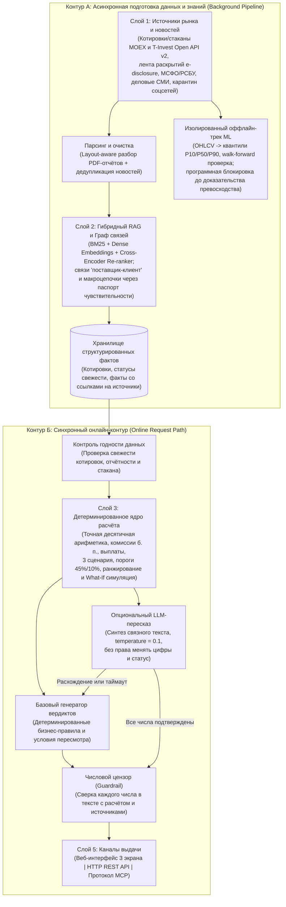

# Аналитическая система VIRA: архитектура, математическое ядро и AI-конвейер для портфельных решений в Т-Инвестициях

## Паспорт решения

| Параметр | Спецификация |
|---|---|
| **Название** | **VIRA** (Virtual Investing Researcher Agent) — интеллектуальный ассистент анализа портфельного риска и сценарного сравнения решений |
| **Предметная область** | Розничное и продвинутое инвестирование на российском фондовом рынке (Мосбиржа, экосистема Т-Инвестиций) |
| **Ключевые задачи пользователя** | 1) Распределение свободных средств при пополнении портфеля; 2) Проверка и пересмотр портфеля при стрессовой новости или просадке позиции; 3) Углублённый разбор отдельной бумаги с проверкой первоисточников; 4) Интерактивное моделирование сделок «Что, если?» |
| **Единый горизонт сравнения** | **21 торговая сессия** (1 биржевой месяц) для контроля рисков, с возможностью просмотра траекторий на срезах **1 день**, **7 дней** и **Месяц** |
| **Ключевой принцип** | Жёсткое разделение зон ответственности: вся финансовая математика, комиссии, выплаты и риск-лимиты считаются детерминированным кодом с точностью до копейки; AI отвечает за извлечение смыслов из отчётности/новостей и человекочитаемое объяснение под контролем детерминированного числового цензора |
| **Текущая готовность** | Работающий веб-прототип (обновлённый 3-экранный интерфейс, живой сбор и фильтрация новостей из официальных лент ЦБ РФ, «Интерфакса» и РБК, детерминированный расчётный движок, агент объяснений с проверкой чисел, интерактивный «Что, если?» симулятор, HTTP REST API, сервер стандарта MCP с 7 инструментами и набор из 19 автоматических приёмочных и сквозных тестов) |

---

## 1. Бизнес-проблема: почему инвестору не хватает обычных графиков и чат-ботов

Частный инвестор с портфелем акций и облигаций (например, на 100 000 ₽) обычно заходит в приложение либо при появлении свободных денег для покупки, либо при выходе тревожных новостей по одной из компаний. На практике он сталкивается с пятью системными проблемами, которые не решаются ни стандартными котировками, ни простым подключением языковой модели.

### 1.1. Пять разрывов текущего пользовательского пути

1. **Иллюзия «хорошей бумаги по отдельности» (слепота к портфельному эффекту).**  
   Люди привыкли оценивать акции изолированно: «акция Б спокойнее акции А — переложу всё в Б». Но даже устойчивая бумага может создать критическую концентрацию в портфеле.  
   *Пример:* в портфеле на 100 000 ₽ проблемная акция занимает 30% (30 000 ₽) и формирует основной вклад в возможный месячный убыток (`−5 400 ₽` из `−7 324 ₽`). Полная перекладка в более спокойную акцию на 22 000 ₽ действительно снижает возможный убыток почти вдвое (до `−4 024 ₽`), но **доля одной компании вырастает до 52% портфеля** — выше безопасного порога в 45%. Без автоматического портфельного пересчёта инвестор меняет один риск на другой.

2. **Ключевые риски спрятаны в текстовых примечаниях к отчётности.**  
   Обычный скринер показывает то, что уже отражено в таблицах прошлого периода (например, рост выручки на 8%). При этом сигналы будущего ухудшения часто содержатся в текстовых сносках к отчётам МСФО/РСБУ и корпоративных раскрытиях: рефинансирование долга под плавающую процентную ставку при высокой долговой нагрузке (`Чистый долг / EBITDA = 3,1×`) или снижение свободного денежного потока (`−11%`).

3. **Информационный шум и невидимые косвенные связи.**  
   В Telegram-каналах и соцсетях официальные раскрытия, деловая пресса и неподтверждённые слухи выглядят одинаково. С другой стороны, обычная лента по тикеру пропускает косвенные события: например, повышение тарифа ключевым поставщиком комплектующих или сдвиг на мировом сырьевом рынке, которые не упоминают название самой компании в заголовке, но напрямую бьют по её себестоимости и марже.

4. **Поведенческие ошибки и отсутствие явной цены компромисса.**  
   Инвесторы склонны покупать волатильные «шумные» бумаги из новостей, либо слишком долго держать падающую позицию в надежде «вернуться в ноль». С другой стороны, при выходе в защитные активы или рубли человек редко видит на одном экране точную цену такого шага — от какого потенциального дохода в хорошем сценарии он отказывается ради снижения риска.

5. **Опасность прямого использования универсальных LLM в финансах.**  
   Если просто передать большой языковой модели портфель и ленту новостей:
   - модель ошибается в арифметике (незаметно округляет суммы, путает рост выручки компании с доходностью акции, теряет комиссии и купоны);
   - при отсутствии биржевого стакана или устаревших котировках модель склонна «додумывать» уверенный ответ вместо остановки;
   - безапелляционные рекомендации «купи/продай» без статуса квалификации и дисклеймеров создают прямые регуляторные риски по Федеральному закону № 39-ФЗ.

### 1.2. Научная база и честное разграничение фактов и гипотез

Архитектура VIRA строится на чётком разделении того, что уже доказано эмпирически, и того, что требует дальнейшей продуктовой или модельной проверки:

| Категория | Что установлено / проверяется | Архитектурное решение в VIRA |
|---|---|---|
| **Подтверждённая база (рынок РФ и исследования)** | • По опросу НАФИ для Банка России (2 023 инвестора), **37%** розничных инвесторов используют Telegram и соцсети при принятии решений. • Исследование Barber & Odean (2008): розница склонна к импульсивным покупкам бумаг, попавших в центр новостного внимания. • Портфельная теория Марковица (1952): итоговый риск определяется весами и структурой всего портфеля, а не отдельной бумагой. • Исследование НИУ ВШЭ по данным Мосбиржи (2015–2024): новостной сентимент статистически связан с оборотами и доходностью на MOEX. • Cohen & Frazzini (2008): экономические связи «поставщик — клиент» передают шоки с задержкой. • Goyal, Welch & Zafirov (2024): точечные ML-прогнозы доходности часто нестабильны вне обучающей выборки. | • Трёхуровневая фильтрация источников с карантином соцсетей. • Обязательный расчёт долей и лимитов для всего портфеля после сделки. • Выделенный канал косвенных связей из примечаний к отчётности. • Отказ от «угадывания одной цены» в пользу трёх сценариев и изоляция ML-прогнозов до прохождения вневыборочной проверки. |
| **Продуктовые гипотезы команды** | Единый 21-дневный горизонт, визуальные шкалы лимитов и разделение каждой новости на «факт / связь / вывод» со ссылкой на первоисточник сокращают время анализа и снижают число импульсивных сделок. | Подлежат проверке на A/B-тесте после пилотного запуска с реальными пользователями. |
| **Исследовательская ML-гипотеза** | Градиентный бустинг (квантильная регрессия) по дневным свечам способен калибровать границы будущей доходности (`P10 / P50 / P90`) точнее нулевого прогноза и скользящих исторических квантилей. | Вынесена в изолированный оффлайн-эксперимент с программной блокировкой попадания в рабочий контур до доказательства качества. |

---

## 2. Пользовательские сценарии и обновлённый интерфейс (3 экрана)

Интерфейс VIRA спроектирован в визуальной системе Т-Инвестиций и объединяет **три связанных экрана**, синхронизированных по выбранному временному горизонту (`1 день`, `7 дней`, `Месяц` — 21 торговый день).

### Экран 1. «Прогноз портфеля» (обзор рисков и вкладов)

В обновлённой версии интерфейса экран начинается с портфеля пополнения на `100 000 ₽` (`90 000 ₽` в бумагах и `10 000 ₽` свободных средств на счёте) и отвечает на три вопроса за один взгляд:

1. **Верхняя 3-колоночная сводка:**
   - *Ваш портфель*: общая стоимость (`100 000 ₽`), стоимость бумаг (`90 000 ₽`), свободно для покупки (`10 000 ₽`) и главное действие — кнопка **«Сравнить варианты»**.
   - *Состав портфеля*: кольцевая диаграмма распределения по классам активов (*Акции 52% / 52 000 ₽*, *Облигации 38% / 38 000 ₽*, *Деньги 10% / 10 000 ₽*).
   - *Что влияет на прогноз*: горизонтальные полосы вклада каждой бумаги в **базовый** сценарий за выбранный период (за месяц: *СеверТех `+1 200 ₽`*, *Вектор `+660 ₽`*, *Город Финанс `+147 ₽`*, *Энергия `+119 ₽`*, итого `+2 126 ₽` или `+2,13%`). Нажатие на любую строку ведёт прямо в карточку бумаги.
2. **Трёхсценарный график и виджет «Требует внимания»:**
   - Слева — график траектории стоимости портфеля по трём сценариям (*Оптимистичный `+5 596 ₽`*, *Базовый `+2 126 ₽`*, *Пессимистичный `−7 244 ₽`*) с интерактивным переключением линий и подсказками.
   - Справа — компактный список конкретных предупреждений со счётчиком (например, `2`) и раскрывающимися чеклистами *«Что проверить»*:
     - **СеверТех: стоимость долга** (рефинансирование под плавающую ставку и падение свободного денежного потока на `11%`);
     - **Энергия: нет стакана** (снимок биржевых заявок недоступен — глубина и спред неизвестны).
3. **Полноширинный блок «Контроль риска»:**
   - **Возможный убыток**: `7 244 ₽ (7,24%)` на шкале с красной отметкой лимита `10%` и явным запасом (`До лимита 2 756 ₽`).
   - **Доля крупнейшей бумаги**: `30% (СеверТех)` на шкале с лимитом `45%` (`До лимита 15 п. п.`).
   - **Из чего складывается убыток**: составная полоса и попозиционная разбивка (`5 400 + 1 540 + 168 + 136 = 7 244 ₽`).
   - Важная защита: даже если пользователь сверху переключает горизонт на `1 день` или `7 дней`, блок «Контроль риска» **всегда считает лимиты на месячном горизонте**, чтобы дневной срез не скрывал реальный риск.
4. **Таблица позиций портфеля:**  
   Показывает текущую сумму, долю и сразу **все три сценарные оценки** каждой бумаги в рублях и процентах, а также статус-индикатор (*«Внимание»*, *«Приемлемый риск»*, *«Часть данных недоступна»*).

### Экран 2. «Карточка бумаги» (разбор причин и первоисточники)

- **Основная колонка (3 вкладки в одной карточке):**
  1. *Цена*: исторический график за 22 точки (текущая и 21 предыдущая сессия) с переключением среза `1 день / 7 дней / Месяц`.
  2. *Три сценария*: прогнозные траектории бумаги на выбранном горизонте и раскрывающийся блок *«Предпосылки сценариев»* (что должно произойти в бизнесе в каждом сценарии).
  3. *Стакан*: таблица заявок покупки и продажи. Если данных нет (пример облигации «Энергия»), вместо выдуманных цифр выводится явное уведомление о недоступности стакана при сохранении расчёта сценариев.
- **Правая колонка:**
  - *Вывод VIRA*: статус риска, ключевой тезис (например, «Рассмотреть докупку» в сценарии пополнения или «Рассмотреть продажу» при стресс-пересмотре), аргументы «за» и «против» и переход к сравнению вариантов.
  - *Новости*: кнопка обновления живой ленты СМИ (**«Обновить ленту СМИ»**), фильтр **«Все / Прямые / Косвенные»**, чёткое указание типа связи и кнопка проверки первоисточника (открывает выдержку из отчёта, раскрытия или делового СМИ с датой и внешней ссылкой).
- **Нижний полноширинный блок показателей эмитента:**
  - Для каждой метрики (*Выручка*, *Чистый долг / EBITDA*, *Свободный денежный поток*, *Номинал*, *Тип купона*, *Валюта*) даётся пояснение её смысла.
  - Блок **«Как читать вместе»** связывает показатели в единый вывод и честно перечисляет недостающие параметры (например, для облигаций — что для окончательного решения дополнительно нужны доходность к погашению, срок и оценка кредитного риска), а кнопка открытия отчёта переводит пользователя к структурированной отчётности или параметрам выпуска.

### Экран 3. «Сравнение вариантов» (выбор без скрытых ловушек)

Переключатель горизонта вынесен в заголовок экрана рядом с названием. На экране отображаются отсортированные карточки допустимых и недопустимых действий (в сценарии пополнения: *Докупить СеверТех* → *Купить Вектор* → *Оставить деньги*; в сценарии пересмотра без кэша: *Продать в деньги* → *Держать* → *Заменить на Вектор*).

В каждой карточке показаны:
- итоговый бейдж (*«Первый вариант»*, *«В пределах лимитов»*, *«Исходный вариант»* или причина нарушения лимитов, например *«Лимит концентрации 45%»*);
- состав портфеля сразу после сделки (`сколько в бумагах / сколько на счёте`);
- итог портфеля по всем трём сценариям с дельтами в рублях и процентах;
- крупнейшая доля;
- раскрывающийся блок **«Расчёт убытка и доли»**, где пользователь может построчно проверить умножение суммы каждой позиции на её сценарную ставку;
- интерактивный симулятор **«Что, если?»** и режим отображения разницы относительно текущего портфеля.

### 2.1. Полная карта экранов, кнопок и функций сайта в рабочей версии

Чтобы жюри видело не только визуальный макет, но и точную механику каждого элемента интерфейса, ниже описано поведение всех интерактивных кнопок, вкладок, фильтров и виджетов сайта в **полной рабочей версии** (с указанием того, что в текущем прототипе уже исполняется в коде, а что работает на демонстрационных данных):

| Экран / область | Элемент управления | Как работает в полной рабочей версии | Статус в текущем прототипе |
| :--- | :--- | :--- | :--- |
| **Верхняя панель (все экраны)** | Выбор счёта / режима портфеля | Загружает через API брокера выбранный реальный брокерский счёт или ИИС инвестора: актуальные позиции, среднюю цену, свободный денежный остаток с учётом расчётов Т+1 и действующий тариф комиссии (в б.п.). Автоматически пересчитывает все три экрана. | Переключение между готовыми сценариями («Есть деньги» и «Пересмотр») и расчёт по выбранному портфелю. |
| **Верхняя панель (все экраны)** | Кнопка **«Обновить ленту СМИ»** и индикатор свежести данных | Запускает внеочередной сбор лент Tier 1 (официальные раскрытия и сообщения ЦБ РФ) и Tier 2 (деловые СМИ: «Интерфакс», РБК), выполняет дедупликацию, привязку к бумагам через Паспорт чувствительности и обновляет события на всех карточках без перезагрузки страницы. При устаревании котировок блокирует торговые советы. | **Работает вживую** через серверный сборщик новостей; в статическом дизайн-макете используется эталонная лента. |
| **Экран 1. Прогноз портфеля** | Переключатель горизонта **«1 день / 7 дней / Месяц»** | Пересчитывает сценарные распределения стоимости портфеля под выбранное окно (с учётом волатильности на коротких окнах и дивидендных отсечек / купонов, попадающих в этот интервал). При этом жёсткие лимиты риска (`10%` убытка и `45%` доли) всегда остаются привязанными к месячному горизонту, чтобы короткие окна не скрывали концентрацию. | На длинном окне «Месяц» считаются полные сценарии с выплатами; в облегчённом макете короткие окна (`1` и `7` дней) аппроксимируются линейным масштабированием. |
| **Экран 1. Прогноз портфеля** | Верхняя сводка (**«Ваш портфель»**, **«Состав портфеля»**, **«Что влияет на прогноз»**) и кнопка **«Сравнить варианты»** | В реальном времени показывает суммарную оценку счёта, разбивку «в бумагах / на счёте» и топ факторов влияния. Клик по любой строке вклада открывает карточку соответствующей бумаги; кнопка **«Сравнить варианты»** переводит на экран подбора допустимых сделок под текущий остаток денег и профиль риска. | Полностью кликабельно и переводит на нужный экран. |
| **Экран 1. Прогноз портфеля** | График портфеля: кнопки серий (**«Оптимистичный / Базовый / Пессимистичный»**) и подсказка по точкам | Позволяют включать и отключать отдельные траектории или сопоставлять весь коридор неопределённости сразу; при наведении или клавиатурном фокусе по точкам отображаются точная дата, расчётная стоимость портфеля в рублях и отклонение в процентах по каждой активной серии. | Полностью интерактивный график с наведением, клавиатурной навигацией и переключением серий. |
| **Экран 1. Прогноз портфеля** | Блок **«Требует внимания»**, кнопка **«Что проверить»** и переходы к бумаге | Автоматически формируется при срабатывании триггеров риска (рост *Чистый долг / EBITDA*, отрицательный свободный денежный поток, пропуск стакана, устаревание цены или приближение доли к `45%`). Кнопка **«Что проверить»** раскрывает конкретный чек-лист действий перед сделкой, а ссылка с названия актива ведёт сразу в карточку проблемной бумаги. | Работает на уровне правил и переходов; раскрывающиеся чек-листы проверены в интерфейсе. |
| **Экран 1. Прогноз портфеля** | Блок **«Контроль риска»**, кликабельные вклады в убыток и подсказка **«Как читать эти оценки»** | Отображает запас до порогов `10%` потерь и `45%` концентрации в рублях и процентных пунктах; полоса вклада в убыток показывает долю каждой бумаги в стресс-сценарии и при клике открывает её карточку. Блок **«Как читать эти оценки»** раскрывает точную методологию расчёта и напоминает, что сценарии не являются гарантией доходности. | Полностью работает с детерминированной проверкой границ и кликабельной детализацией вклада. |
| **Экран 1. Прогноз портфеля** | Таблица **«Позиции портфеля»** (кликабельные строки) | Сортирует бумаги по весу или риску, показывает текущую сумму и долю, итог по трём сценариям и 4-уровневый статус (*«Приемлемый риск»*, *«Внимание»*, *«Высокий риск»*, *«Часть данных недоступна»*). Клик по строке открывает карточку бумаги с выбранным горизонтом. | Работает полностью. |
| **Экран 2. Карточка бумаги** | Навигация **«‹ К портфелю»** и кнопка **«Сравнить варианты»** | Возвращает на главный обзор с сохранением выбранного портфеля и горизонта либо переносит в экран сравнения с предзагруженными вариантами действий именно по этой бумаге. | Работает полностью. |
| **Экран 2. Карточка бумаги** | Вкладки карточки: **«Цена»**, **«Три сценария»**, **«Стакан»** и переключатели серий/горизонта | **«Цена»** строит исторический ряд закрытий и дневных изменений из биржевого потока; **«Три сценария»** выводит коридор P90 / P50 / P10 и кривые на выбранном окне; **«Стакан»** подгружает живые заявки покупки/продажи, объёмы и спред в базисных пунктах — а если ликвидности или стакана нет, показывает честное предупреждение без додумывания чисел. | В прототипе показаны 22-дневные ряды, сценарные траектории и пример реального пропуска стакана по облигации. |
| **Экран 2. Карточка бумаги** | Раскрывающийся блок **«Предпосылки сценариев»** и карточка **«Вывод VIRA»** | **«Предпосылки»** фиксируют проверяемые фундаментальные условия каждого сценария (например, маржа, капитальные затраты, динамика ставки); **«Вывод VIRA»** собирает статус риска, аргументы «за» и «против» и условия пересмотра, проходя жёсткую проверку числовым цензором перед показом пользователю. | Работает под контролем числового цензора; при галлюцинации автоматически срабатывает откат к безопасному шаблону. |
| **Экран 2. Карточка бумаги** | Блок **«Новости»**: фильтры **«Все / Прямые / Косвенные»** и кнопка проверки источника | Фильтрует события по типу связи: **«Прямые»** (события самого эмитента) и **«Косвенные»** (макро-решения ЦБ, пошлины, смежные отрасли, привязанные через Паспорт чувствительности). Клик по источнику открывает окно с разбором *Факт / Основание / Трактовка VIRA*, уровнем доверия (Tier 1/2) и прямой ссылкой на официальный документ или публикацию СМИ. | **Работает вживую** (ЦБ РФ, «Интерфакс», РБК) с фильтрацией, модальным окном источника и внешней ссылкой. |
| **Экран 2. Карточка бумаги** | Блок **«Финансовые показатели»** / **«Параметры выпуска»**, **«Как читать вместе»** и кнопка **«Открыть отчёт»** | Поясняет ключевые мультипликаторы акций или параметры облигаций. В полной версии блок облигаций включает расчёт доходности к погашению (YTM), дюрации, накопленного купонного дохода и кредитного рейтинга, а кнопка **«Открыть отчёт»** открывает нужный раздел отчётности МСФО/РСБУ или решения о выпуске ценных бумаг с подсветкой фрагментов первоисточника. | В текущем прототипе для облигаций явно указана неполнота параметров для финальной сделки, а кнопка открывает учебную выписку отчёта. |
| **Экран 3. Сравнение вариантов** | Карточки вариантов и раскрывающийся блок **«Расчёт убытка и доли»** | Показывают ранжированные альтернативы (от лучшей допустимой к исходной и заблокированным лимитами). Учитываются комиссия брокера, чистая выручка и дивиденды/купоны в окне горизонта. Блок **«Расчёт убытка и доли»** раскрывает построчное умножение суммы каждой позиции на её сценарную ставку с точным сведением до копейки. | Работает полностью с точным округлением до копейки и блокировкой вариантов, нарушающих пороги `45%` или `10%`. |
| **Экран 3. Сравнение вариантов** | Симулятор **«Что, если?»** и переключатель **«Показать разницу»** | Позволяет инвестору задать произвольную частичную продажу (от `1%` до `100%` позиции), частичную покупку за счёт свободного кэша или замену одной бумаги на другую с выбором ставки комиссии в базисных пунктах — и мгновенно увидеть пересчёт сценариев, долей и проверку лимитов, а также разницу (`Δ`) относительно текущего портфеля. Автоторговля отсутствует: после проверки пользователь переходит в стандартную форму заявки брокера для ручного подтверждения. | **Работает в серверном веб-интерфейсе** и по REST/MCP; в статическом дизайн-макете зафиксированы эталонные варианты для визуальной приёмки. |

---

## 3. Сквозная архитектура системы: два изолированных контура

Чтобы тяжёлый разбор PDF-отчётов и новостных потоков не замедлял интерфейс, архитектура VIRA разделена на два контура:

- **Контур А (Асинхронный фоновый конвейер подготовки знаний и моделей):** работает по расписанию и событиям рынка. Парсит отчётность, фильтрует новости, строит векторный и лексический индексы, выявляет прямые и косвенные связи между компаниями, обновляет карточки фактов и в изолированной лаборатории обучает/валидирует ML-модели.
- **Контур Б (Синхронный онлайн-конвейер обработки запроса):** обслуживает нажатия пользователя, REST API и внешние запросы AI-ассистентов. Выполняет только быстрые операции поверх уже подготовленных структурированных данных: контроль свежести, точную финансовую математику, ранжирование вариантов, формулировку вывода и автоматическую проверку чисел цензором.

### 3.1. Распределение ответственности: Код vs Классический ML vs LLM + RAG

| Задача | Механизм исполнения | Почему выбран именно он |
|---|---|---|
| Расчёт стоимости, долей, дивидендов/купонов, комиссий (`bps`), сценариев и дельт | **Детерминированный код** (точная десятичная арифметика с округлением `HALF_UP` до `0,01`) | Исключает погрешности двоичного `float` и гарантирует 100% воспроизводимость каждой копейки. |
| Проверка лимитов (`45%` концентрация, `10%` убыток), светофор, фильтрация и сортировка вариантов | **Детерминированный код** | Защитные барьеры не могут зависеть от вероятностных весов модели; границы проверяются без погрешностей деления. |
| Блокировка советов при нехватке/устаревании данных | **Детерминированный код** (предохранитель свежести) | Гарантирует честную паузу вместо «угадывания», если отчётность или котировки неактуальны. |
| Разбор сносок МСФО/РСБУ, сопоставление новостей, извлечение связей «поставщик — клиент» и макроцепочек | **LLM + Гибридный RAG** (в Контуре А, асинхронно) | Понимание неструктурированного делового русского языка и причинно-следственных связей невозможно реализовать регулярными выражениями. |
| Калибровка квантилей доходности (`P10 / P50 / P90`) по ценовым свечам | **Классический табличный ML** (градиентный бустинг, в оффлайн-эксперименте) | Табличные финансовые ряды требуют квантильной регрессии и строгой вневыборочной валидации, а не языковой модели. |
| Генерация человекочитаемого пояснения поверх готовых цифр | **Базовые правила** + опциональная **LLM** под фильтром **числового цензора** | Понятный язык без риска подмены чисел и полной деградации сервиса при сбое внешнего API. |

### 3.2. Граница между реализованным прототипом и целевым продакшеном

Для прозрачности оценки текущее состояние разделено на две зоны:
- **Уже реализовано и проверяется в исполняемом прототипе:**
  - обновлённый 3-экранный адаптивный веб-интерфейс (проверен на ширинах `320–1440 px` и с клавиатурной навигацией);
  - полное детерминированное ядро расчёта портфельных сценариев, комиссий, дивидендов/купонов, порогов `45% / 10%`, ранжирования и What-If симуляции частичной продажи/замены;
  - контроль неполных данных (отсутствующий стакан, устаревшие котировки и пропуски отчётности);
  - живой сбор, дедупликация и фильтрация новостей (ЦБ РФ — Tier 1, «Интерфакс» и РБК — Tier 2, карантин Tier 3) с привязкой к бумагам через Паспорт чувствительности;
  - агент объяснений (режим бизнес-правил + подключаемый LLM-адаптер) с числовым цензором и автоматическим откатом;
  - HTTP REST API и полноценный MCP-сервер (7 инструментов JSON-RPC, включая сбор и фильтрацию живых новостей) с паспортом трассировки каждого ответа;
  - подтверждённая работа на наборе эталонных сценариев (проверено 19 автотестами).
- **Целевой промышленный контур при интеграции с брокером:**
  - потоковая подписка на котировки и L2-стаканы через **Т-Инвестиции Open API v2** и MOEX;
  - расчёт полной облигационной аналитики (доходность к погашению YTM, дюрация, накопленный купонный доход и кредитные рейтинги выпусков);
  - асинхронный парсер PDF-отчётности, гибридный векторно-лексический индекс, автоматический граф контрагентов и макроцепочек;
  - выделенный GPU-контур с семантическим кэшированием карточек при выходе отчётности (один прогон на эмитента для всей клиентской базы) и завершение оффлайн-валидации ML-квантилей.

---

## 4. Пошаговая спецификация обработки данных и вычислений

### Шаг 1. Приём данных, иерархия доверия и контроль свежести

Система работает с пятью потоками: снимком портфеля (позиции, кэш, комиссия), котировками и 22-дневной историей цен, биржевым стаканом L2, календарём дивидендов/купонов и новостной/отчётной базой.

**Трёхуровневый фильтр доверия к текстовым источникам:**
1. **Tier 1 (Официальный контур):** официальные ленты Банка России (новости и события), корпоративные раскрытия, отчёты МСФО/РСБУ, биржевые данные. Могут менять фундаментальный статус компании и попадают в основные аргументы.
2. **Tier 2 (Деловая пресса):** проверенные информационные агентства и деловые СМИ («Интерфакс», РБК). Используются для своевременного анализа до публикации квартальных отчётов, с автоматической дедупликацией и обязательным отделением подтверждённого факта от комментария (на контрольном прогоне живых лент из `80` сырых публикаций после очистки от дубликатов осталось `60`, из них `16` были адресно привязаны к бумагам портфеля).
3. **Tier 3 (Соцсети и Telegram, включая «Пульс»):** **карантинная зона**. Сообщения без подтверждения в Tier 1 / Tier 2 не допускаются в аргументацию VIRA и могут использоваться только как фоновый маркер повышенного рыночного внимания.

**Два режима реакции на неполноту данных:**
- *Локальный пропуск (отсутствует только биржевой стакан, пример облигации «Энергия»):* портфельные сценарии и риск-метрики продолжают считаться, но в обзоре появляется предупреждение «нет стакана», а карточка выпуска явно просит проверить ликвидность перед сделкой.
- *Критический пропуск (котировки устарели или отсутствует отчётность):* система блокирует активный вывод формулировкой *«Недостаточно данных для вывода»*, перечисляет конкретные пробелы, но всё равно предупреждает инвестора, если даже по доступным данным уже нарушен лимит портфеля (`45%` или `10%`).

---

### Шаг 2. Информационный конвейер: гибридный RAG и двухканальный граф связей

1. **Разбор документов (Контур А):** PDF-отчёты МСФО/РСБУ проходят layout-aware парсинг с сохранением структуры таблиц и текстовых примечаний (где скрыты ковенанты, структура долга и контракты с поставщиками).
2. **Гибридный поиск (Hybrid RAG):**
   - лексический поиск (`BM25`) гарантирует точное попадание по тикерам, номерам выпусков и конкретным числовым показателям;
   - векторный поиск (`Dense Embeddings`) находит смысловые совпадения (например, «ставка рефинансирования» ↔ «расходы на обслуживание долга»);
   - переранжирование (`Cross-Encoder Re-ranker`) отбирает наиболее релевантные фрагменты для карточки.
3. **Двухканальная детекция связей (`Прямые` vs `Косвенные`):**
   - **Прямой канал:** события самого эмитента.
   - **Косвенный канал:** (а) документально подтверждённые связи «поставщик — клиент» из примечаний к отчётности (как рост тарифов поставщика комплектующих для СеверТеха); (б) макро- и отраслевые цепочки, сопоставляемые LLM с заранее собранным **Паспортом чувствительности эмитента** (зависимость выручки и маржи от сырья, ставок, валюты и рынков сбыта) и пропускаемые через фильтр значимости.
4. **Строгий формат каждого факта:** система никогда не выдаёт смешанный пересказ. Каждая запись хранит 4 раздельных элемента: *проверяемый факт*, *основание связи с бумагой*, *интерпретация влияния* и *ссылка на первоисточник с датой*.

---

### Шаг 3. Детерминированное математическое ядро

Все вычисления выполняются без участия нейросетей в точной десятичной арифметике (`Decimal`, округление `ROUND_HALF_UP` до `0,01 ₽` и `0,01%`).

1. **Пересчёт сценарных ставок по горизонту:**  
   Для каждой бумаги на базовом горизонте `21` торговая сессия заданы 3 сценарные ставки ($r_{\text{opt}}, r_{\text{base}}, r_{\text{pess}}$). Для коротких срезов (`1` или `7` дней) в интерфейсе ставка масштабируется линейно:
   $$r_s(d) = r_s(21) \times \frac{d}{21}$$
   Вклад каждой бумаги $i$ в сценарий $s$:
   $$\Delta V_{i,s} = \text{round}\left(A_i \times \frac{r_s(d)}{100}\right)$$
   где $A_i$ — стоимость позиции после моделируемой сделки (с учётом чистой выручки и удержанной комиссии при замене или покупке).

2. **Итоговая формула портфеля на горизонте (`21` сессия):**
   $$\text{Результат}_s = \sum_{i} \Delta V_{i,s} + \text{Дивиденды}_{\text{в горизонте}} + \text{Купоны}_{\text{в горизонте}} - \text{Комиссии}$$
   При частичной продаже позиции календарные выплаты по ней масштабируются пропорционально оставшемуся объёму.

3. **Учёт комиссий при сделке (в базисных пунктах):**  
   При покупке на доступный кэш $C$ с комиссионной ставкой $b$ (в `bps`) чистая сумма покупки и комиссия рассчитываются так, чтобы $A_{\text{buy}} + F_{\text{buy}} = C$ без выхода за остаток средств. При полной или частичной замене новая позиция покупается строго на **чистую выручку** от продажи предыдущей (после вычета комиссии за продажу).

4. **Два жёстких порога риска (всегда на месячном горизонте `21` день):**
   - **Порог концентрации:** доля любой бумаги после сделки $\ge 45{,}00\%$ → красный статус нарушения. Проверка выполняется перекрёстным умножением ($\text{Макс. позиция} \times 100 \ge 45 \times \text{Портфель}$), исключая обход порога из-за округления `44,996%`.
   - **Порог пессимистичного убытка:** месячный убыток в плохом сценарии $\ge 10{,}00\%$ от исходного портфеля → красный статус нарушения.

5. **Ранжирование вариантов в «Сравнении»:**
   - сначала отбрасываются варианты, нарушающие пороги `45%` или `10%`, имеющие критический дефицит данных или не улучшающие портфель относительно удержания;
   - в режиме **пополнения** допустимые варианты ранжируются по **максимуму базового результата**;
   - в режиме **пересмотра** (без кэша) допустимые варианты ранжируются по **минимуму пессимистичного убытка**, а при равенстве — по **меньшей концентрации**;
   - недопустимые варианты не скрываются, а показываются после допустимых с явной причиной блокировки (например, «Лимит концентрации 45%»).

---

### Шаг 4. Откуда берутся 3 сценарные доходности: текущий эталон vs оффлайн-методика ML

Чтобы исключить иллюзии вокруг точности рыночных прогнозов, система жёстко разделяет демонстрационные эталоны и промышленный ML-контур:

- **В текущем прототипе:** 3 сценарные ставки на 21 сессию для каждой бумаги заданы как фиксированные эталонные параметры (например, `+12% / +4% / −18%` для волатильной акции с высоким долгом, `+7% / +3% / −7%` для более устойчивой акции, `+1,2% / +0,7% / −0,8%` для облигаций). Это позволяет полностью проверить портфельную математику, дельты и лимиты без искажения шумом необученной модели.
- **В целевой системе (исследовательский трек для акций и структурная модель для облигаций):**
  - Для **акций** три сценария интерпретируются как три квантиля распределения 21-дневной доходности: пессимистичный (`P10`), медианный базовый (`P50`) и оптимистичный (`P90`). Оценивать их должна табличная **квантильная регрессия (градиентный бустинг)** по признакам дневных свечей OHLCV (доходности, волатильность, диапазон, относительный объём).
  - Для **облигаций** в боевом контуре сценарный коридор должен строиться аналитически через дюрацию, сдвиг кривой ставок, купонный доход и кредитный спред (в текущей карточке выпуска пользователь прямо предупреждён, что YTM, срок и кредитный риск пока не включены).
  - **Критерии допуска ML в продукт:** строгая хронологическая **walk-forward валидация** (обучение строго на прошлом с защитным разрывом embargo в `21` сессию) против двух честных бейзлайнов — наивного прогноза `0%` и скользящих исторических квантилей. Оценка ведётся по `MAE` (для `P50`), **Pinball Loss** (для `P10 / P90`) и **эмпирическому покрытию** интервала `[P10, P90]` (целевой ориентир — около `80%`).
  - **Программный замок:** в онлайн-контуре стоит явный флаг отключения ML-прогноза до прохождения этой проверки. Кроме того, по методологии проекта квантили отдельных акций трактуются как **условный стресс-сценарий портфеля**, а не точный портфельный `P10` (для которого требуется учёт матрицы корреляций).

---

### Шаг 5. AI-агент объяснений и детерминированный цензор (`Guardrail`)

Слой объяснений работает поверх уже готовых расчётов и никогда не изменяет сами числа:

1. **Надёжный режим по умолчанию (Детерминированные бизнес-правила):** формирует заголовок вердикта (*«Докупить»*, *«Рассмотреть продажу»*, *«Недостаточно данных для вывода»*, *«Высокий риск, подходящий вариант не найден»*), аргументацию с явным компромиссом и условие пересмотра позиции. Работает мгновенно и без внешних API.
2. **Опциональный LLM-режим:** перефразирует обоснование в естественный деловой стиль (`temperature = 0.1`), получая в контекст только готовый JSON расчётов, статус и проверенные факты.
3. **Числовой цензор нулевой толерантности:**
   - перед выдачей ответа из всех расчётных объектов, метрик эмитента, новостей и первоисточников собирается белый список разрешённых чисел;
   - парсер извлекает **каждое число** из сгенерированного текста (включая суммы с пробелами вроде `7 244`, проценты и мультипликаторы вроде `3,1`);
   - если найдено хотя бы одно число, отсутствующее в эталоне (с допуском `0,05`), ответ LLM немедленно блокируется, а пользователь получает гарантированно точный текст из базового генератора правил.

---

### Шаг 6. Интеграция, бюджет задержек и экономика инференса

1. **Единые каналы доставки:**
   - **Веб-приложение (3 экрана)** через HTTP REST API (включая интерактивный симулятор произвольной частичной продажи, покупки и замены с настраиваемой комиссией и кнопку обновления живой ленты новостей).
   - **Протокол MCP (Model Context Protocol, JSON-RPC 2.0):** 7 инструментов (`список портфелей`, `обзор портфеля`, `анализ бумаги`, `сравнение вариантов`, `What-If симулятор`, `сбор и обновление живых новостей`, `получение отфильтрованной ленты новостей`) позволяют подключить расчётное ядро VIRA напрямую к корпоративному чат-ассистенту Т-Банка, чтобы ассистент не «считал портфель в уме» и опирался на проверенные первоисточники.
2. **Бюджет задержек (Latency Budget):**
   - Синхронный онлайн-путь без LLM (расчёт `Decimal`, ранжирование, правила и цензор) выполняется за **единицы миллисекунд** (сетевой отклик API укладывается в `< 50–150 мс`).
   - Тяжёлые операции (парсинг МСФО, RAG-индексация, извлечение связей) полностью вынесены в фоновый Контур А и не влияют на скорость клика.
3. **Экономика инференса (снижение стоимости LLM):**
   - Вместо генерации аналитики по каждой бумаге при каждом входе пользователя в приложение работает **событийная предгенерация с кэшированием**: при выходе отчётности или существенного факта карточка эмитента обновляется один раз и переиспользуется для всех владельцев этой бумаги в базе клиентов. Вкупе с высокой концентрацией розничных портфелей в топ-бумагах MOEX это снижает потребность в онлайн-вызовах LLM на порядки.

---

## 5. Регуляторное соответствие (39-ФЗ), матрица рисков и проверка контрольными расчётами

### 5.1. Границы по Федеральному закону № 39-ФЗ и требованиям ЦБ РФ

VIRA принципиально работает как **информационно-аналитический сценарный калькулятор**, а не как система автоследования или индивидуального инвестиционного консультирования (ИИК):
- не выставляет биржевые заявки и не имеет доступа к подписанию поручений;
- не формирует индивидуальный риск-профиль клиента по 39-ФЗ и не даёт императивных приказов «срочно купи/продай»;
- показывает равноправное сравнение сценариев на едином горизонте с явным раскрытием цены компромисса, ограничений учебных порогов (`45% / 10%`) и условий пересмотра позиции.

### 5.2. Матрица ключевых рисков и меры защиты

| Риск | Критичность | Защита в архитектуре и предварительная проверка |
|---|---|---|
| **Числовая или фактическая галлюцинация LLM** | Критическая (подрыв доверия и финансовая ошибка) | LLM не допускается к арифметике; пост-проверка каждого числа парсером против белого списка с автоматическим откатом на шаблон правил. |
| **Выдача вывода по устаревшим данным или без стакана** | Высокая (ложная уверенность в неликвиде) | Строгий предохранитель свежести: блокировка активных советов при просроченных котировках/отсутствии отчётности и явный маркер при отсутствии стакана. |
| **Манипуляции и «памп» из Telegram-каналов** | Высокая (побуждение к импульсивной сделке) | Карантин источников соцсетей: без подтверждения в официальных раскрытиях или деловых СМИ события не попадают в аргументацию VIRA. |
| **Переобучение ML-модели на прошлых режимах MOEX** | Высокая (ложные границы `P10 / P90` при смене режима рынка) | Изоляция ML-трека под программным замком; обязательный walk-forward экзамен против нулевого и исторического бейзлайнов. |
| **Нарушение границ 39-ФЗ (признаки ИИК)** | Критическая (регуляторный стоп-фактор) | Сценарная форма вывода («что изменится при таком действии»), явный показ минусов каждого варианта, дисклеймеры и сохранение финального решения за инвестором. |

---

### 5.3. Контрольные расчётные кейсы и верификация

Все формулы и правила архитектуры проверены на двух эталонных портфелях по `100 000 ₽` (на базовом горизонте `21` торговая сессия):

1. **Сценарий пополнения (основной демо-кейс: `90 000 ₽` в бумагах + `10 000 ₽` свободных средств):**
   - Текущие вклады в базовый сценарий: СеверТех `+1 200 ₽`, Вектор `+660 ₽`, Город Финанс `+147 ₽`, Энергия `+119 ₽` = **`+2 126 ₽ (+2,13%)`**.
   - Текущий риск за месяц: возможный убыток **`7 244 ₽ (7,24%)`** (запас до лимита `10%` — `2 756 ₽`), крупнейшая доля **`30%` (СеверТех)** (запас до лимита `45%` — `15 п. п.`).
   - Сравнение вложения `10 000 ₽`:
     1. *Докупить СеверТех* (**Первый вариант**): базовый результат `+2 526 ₽` (`+400 ₽` к исходному), убыток `9 044 ₽ (9,04% < 10%)`, доля `40% < 45%`.
     2. *Купить Вектор* (в пределах лимитов): базовый результат `+2 426 ₽`, убыток `7 944 ₽ (7,94%)`, доля `32%`.
     3. *Оставить деньги* (исходный вариант): базовый результат `+2 126 ₽`, убыток `7 244 ₽`, доля `30%`.

2. **Сценарий стресс-пересмотра (`100 000 ₽` в бумагах, `0 ₽` свободных средств):**
   - Текущий месячный убыток: **`−7 324 ₽`** (из них СеверТех `−5 400 ₽`, Вектор `−1 540 ₽`, Город Финанс `−200 ₽`, Энергия `−184 ₽`).
   - Сравнение действий:
     1. *Продать СеверТех и оставить деньги* (**Первый вариант**): снижает убыток до **`−1 924 ₽`** и долю до **`25%`**, при честном показе компромисса — снижение оптимистичного итога на `3 600 ₽`.
     2. *Держать СеверТех* (исходный вариант): убыток `−7 324 ₽`, доля `30%`.
     3. *Заменить на Вектор* (запрещено правилами): снижает убыток до `−4 024 ₽`, но создаёт **красное нарушение лимита концентрации `52% > 45%`**.

**Итог проверки прототипа:**  
Все 19 автоматических приёмочных, новостных и сквозных браузерных тестов (включая точные граничные значения `44,99%` против `45,00%` и `9,999%` против `10,00%`, учёт дивидендов/купонов и комиссий, живой сбор и дедупликацию новостей из лент ЦБ РФ, «Интерфакса» и РБК с последующей проверкой цензором, блокировку вывода при устаревших данных, перехват числовых галлюцинаций LLM цензором, частичную What-If симуляцию, HTTP API и все 7 инструментов протокола MCP) пройдены полностью успешно (`19/19 OK`), а обновлённый дизайн-макет и живая лента новостей проверены в браузере на ширинах `320–1440 px` без горизонтальной прокрутки и ошибок.
