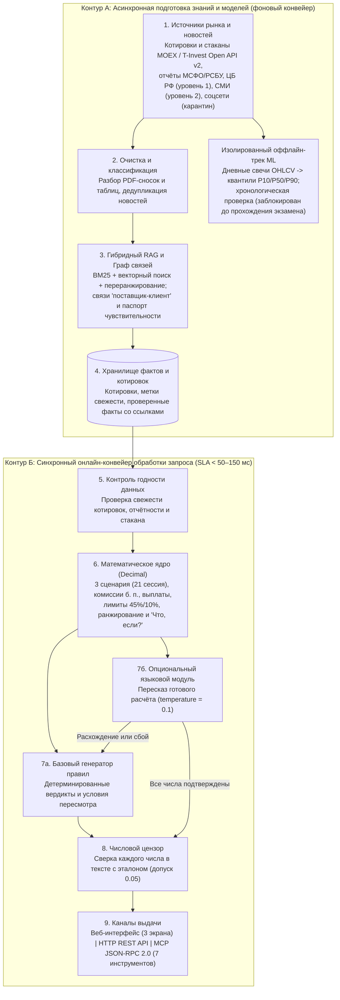

# Научно-технический отчёт о проделанной работе и архитектуре аналитической системы VIRA

**Адресат:** Экспертное жюри конкурсного отбора (Т-Банк / Т-Инвестиции)  
**Объект:** Аналитическая система VIRA (*Virtual Investing Researcher Agent*) — интеллектуальный ассистент анализа портфельного риска и сценарного сравнения решений  
**Предметная область:** Розничное и продвинутое инвестирование на российском фондовом рынке (Московская биржа, экосистема Т-Инвестиций)  
**Текущая готовность:** Рабочий веб-прототип с детерминированным расчётным ядром, живым сбором и фильтрацией новостей официальных и деловых источников, программным интерфейсом REST API, сервером стандарта MCP (7 инструментов) и полным прохождением 27 автоматических приёмочных, модульных и сквозных браузерных проверок.

---

## 1. Постановка задачи и научная база решения

### 1.1. Пять системных разрывов текущего пользовательского пути

При анализе поведения частного инвестора с портфелем акций и облигаций (на типовом примере в 100 000 руб.) выявлены пять системных проблем, которые не решаются ни стандартными графиками котировок, ни прямым подключением универсальной языковой модели (LLM):

1. **Иллюзия оценки отдельной бумаги (слепота к портфельному эффекту).** Инвесторы привыкли оценивать инструменты изолированно. На контрольном портфеле в 100 000 руб. проблемная акция занимает 30% (30 000 руб.) и формирует основной вклад в возможный месячный убыток (`−5 400 руб.` из `−7 324 руб.`). Полная перекладка этой позиции в более спокойную бумагу снижает расчётный убыток до `−4 024 руб.`, однако увеличивает долю одного эмитента до **52% портфеля** — выше безопасного порога концентрации в 45%. Без автоматического портфельного пересчёта инвестор замещает один риск другим.
2. **Скрытые фундаментальные риски в текстовых примечаниях к отчётности.** Обычные табличные скринеры отражают ретроспективные показатели (например, рост выручки на 8%), тогда как сигналы будущего ухудшения устойчивости находятся в текстовых сносках к отчётам МСФО/РСБУ и корпоративным раскрытиям: рефинансирование долга под плавающую процентную ставку при высокой долговой нагрузке (`Чистый долг / EBITDA = 3,1x`) или сокращение свободного денежного потока (`−11%`).
3. **Информационный шум и невидимые косвенные связи.** В социальных сетях и мессенджерах официальные раскрытия, деловая пресса и неподтверждённые слухи выглядят одинаково. С другой стороны, обычная лента новостей по тикеру пропускает косвенные события — повышение тарифов ключевым поставщиком, решения Банка России или сдвиги на мировых сырьевых рынках, влияющие на себестоимость и маржу компании без упоминания её названия в заголовке.
4. **Поведенческие ошибки и отсутствие количественной цены компромисса.** Розничные участники рынка склонны к импульсивным покупкам бумаг из новостного потока или длительному удержанию падающих позиций, а при выходе в защитные активы и денежные средства редко видят на одном экране точную цену такого шага — от какого потенциального результата в оптимистичном сценарии они отказываются ради снижения риска.
5. **Опасность неконтролируемого применения LLM в финансах.** Прямая передача портфеля и ленты новостей большой языковой модели приводит к арифметическим ошибкам (потеря комиссий, купонов и погрешности округления), «додумыванию» уверенного ответа при устаревших котировках или отсутствии биржевого стакана, а также к прямым регуляторным рискам по Федеральному закону № 39-ФЗ при выдаче императивных торговых советов.

### 1.2. Разграничение подтверждённых фактов и проверяемых гипотез

| Категория | Установленная научная база или проверяемая гипотеза | Отражение в архитектуре системы VIRA |
| :--- | :--- | :--- |
| **Подтверждённая эмпирическая база** | По опросу НАФИ для Банка России (2 023 инвестора), 37% розничных инвесторов используют Telegram и соцсети при принятии решений. Исследование Barber & Odean (2008) показало склонность розницы к импульсивным покупкам бумаг, попавших в центр новостного внимания. Портфельная теория Марковица (1952) доказывает, что риск определяется структурой и весами всего портфеля. Исследование НИУ ВШЭ по данным Мосбиржи (2015–2024) подтвердило статистическую связь новостного сентимента с оборотами и доходностью на российском рынке. Работа Cohen & Frazzini (2008) показала передачу шоков с задержкой по связям «поставщик — клиент». Goyal, Welch & Zafirov (2024) обосновали нестабильность точечных ML-прогнозов доходности вне обучающей выборки. | Трёхуровневая фильтрация источников с карантином соцсетей; обязательный расчёт долей и порогов риска для всего портфеля после моделируемой сделки; выделенный канал косвенных связей из примечаний к отчётности; отказ от точечного угадывания цены в пользу трёх сценарных траекторий и изоляция ML-прогнозов до прохождения строгой вневыборочной проверки. |
| **Продуктовые гипотезы команды** | Единый горизонт в 21 торговую сессию (1 биржевой месяц), наглядные шкалы лимитов и разделение каждой новости на проверяемый факт, основание связи, интерпретацию и ссылку на первоисточник сокращают время анализа и снижают частоту импульсивных сделок. | Подлежат проверке в A/B-эксперименте на пилотном запуске с реальными инвесторами. |
| **Исследовательская ML-гипотеза** | Табличный градиентный бустинг (квантильная регрессия) по дневным свечам OHLCV способен калибровать границы будущей 21-дневной доходности (`P10 / P50 / P90`) точнее нулевого прогноза и скользящих исторических квантилей. | Вынесена в изолированный оффлайн-эксперимент с программной блокировкой попадания в рабочий онлайн-контур до доказательства качества. |

---

## 2. Проделанная работа по этапам создания системы

Работа выполнена последовательно через четыре взаимосвязанных этапа проектирования, исследования, разработки и верификации:

### Этап 1. Исследование рынка, экономическое обоснование и базовое риск-ядро
- Проведён эмпирический анализ российского рынка (Мосбиржа, 2022–2024 гг.) по превентивному выявлению скрытых долговых и процентных рисков в сносках к отчётности МСФО/РСБУ, а также сформулированы правовые границы системы в рамках Федерального закона № 39-ФЗ.
- Выполнено финансово-экономическое моделирование для вселенной из ~590 активных инструментов Московской биржи (~240 эмитентов акций и ~350 выпусков корпоративных облигаций) с оценкой ~7 480 событий корпоративных раскрытий в год, расчётом бюджета токенов, пропускной способности и стоимости обслуживания одного активного клиента.
- Создан первый автономный прототип риск-аудита с расчётом дневного показателя стоимости под риском (VaR 95%), долговой нагрузки (`Чистый долг / EBITDA`), коэффициента покрытия процентов, симулятором защитной ротации в инструменты денежного рынка и набором из 8 модульных тестов.

### Этап 2. Системный анализ и формализация бизнес-правил
- Сформированы требования и бизнес-модель продукта для четырёх ключевых пользовательских сценариев:
  1. распределение свободных средств при пополнении портфеля;
  2. проверка и пересмотр портфеля при стрессовой новости или просадке позиции (без свободных средств);
  3. углублённый разбор отдельной бумаги с проверкой первоисточников;
  4. интерактивное моделирование произвольных сделок «Что, если?» (частичная продажа, покупка, замена).
- Зафиксирован единый горизонт сравнения рисков — **21 торговая сессия** (1 биржевой месяц) с возможностью просмотра траекторий на срезах `1 день`, `7 дней` и `Месяц`.
- Определены жёсткие защитные пороги (`45%` максимальной доли одной бумаги и `10%` возможного месячного убытка), правила ранжирования альтернатив и система контрольных расчётных примеров на портфелях по 100 000 руб. для однозначной приёмки.

### Этап 3. Проектирование трёхуровневого интерфейса
- Спроектирован и доведён через серию итераций кликабельный интерфейс в визуальной системе Т-Инвестиций, объединяющий **три связанных экрана**:
  1. **Экран «Прогноз портфеля»:** сводка стоимости (общая стоимость, в бумагах, свободные средства и переход к сравнению вариантов), распределение по классам активов, вклады отдельных бумаг в базовый сценарий, трёхсценарный график траекторий стоимости, блок предупреждений «Требует внимания» с раскрывающимися чеклистами проверки, полноширинный блок «Контроль риска» (фиксирующий лимиты на месячном горизонте даже при переключении верхнего среза на `1` или `7` дней) и таблица позиций.
  2. **Экран «Карточка бумаги»:** вкладки *Цена* (22-дневная история), *Три сценария* (с раскрывающимися фундаментальными предпосылками) и *Стакан* (с честным предупреждением о недоступности стакана без выдумывания чисел); правая колонка с *Выводом VIRA* и лентой *Новостей* (фильтр *Все / Прямые / Косвенные* и окно проверки первоисточника с датой и прямой ссылкой); нижний блок показателей эмитента с пояснением их смысла и явным указанием недостающих параметров для облигаций.
  3. **Экран «Сравнение вариантов»:** переключатель горизонта в заголовке экрана, отсортированные карточки допустимых и заблокированных действий (с явной причиной нарушения лимита, например «Лимит концентрации 45%»), раскрывающийся построчный «Расчёт убытка и доли» для проверки каждой позиции до копейки и режим отображения разницы относительно исходного портфеля.
- Интерфейс проверен в браузере на ширинах экрана `320`, `390`, `768`, `1123` и `1440 px` с клавиатурной навигацией, без горизонтальной прокрутки и ошибок исполнения.

### Этап 4. Реализация серверного веб-MVP, живого новостного конвейера и интерфейсов интеграции
- Вся расчётная и агентная логика выделена из интерфейса в независимый проверяемый программный контур на точной десятичной арифметике (`Decimal`, округление `ROUND_HALF_UP` до `0,01`).
- Реализованы: детерминированный расчётный движок (сценарии, комиссии в базисных пунктах, дивиденды и купоны, границы рисков, ранжирование и «Что, если?» симулятор), живой сборщик и фильтр финансовых новостей (ЦБ РФ, «Интерфакс», РБК, карантин соцсетей), агент объяснений с числовым цензором, HTTP REST API, сервер стандарта **MCP (JSON-RPC 2.0)** с **7 инструментами** и сквозной комплекс из **19 приёмочных, новостных и браузерных тестов**.

---

## 3. Архитектура системы: как работает VIRA

### 3.1. Двухконтурная архитектура обработки данных и запросов

Чтобы тяжёлый синтаксический разбор PDF-отчётности МСФО/РСБУ, очистка новостных лент и векторно-лексическое индексирование не замедляли работу пользователя, архитектура разделена на два изолированных контура:

- **Контур А (Асинхронный фоновый конвейер подготовки знаний и моделей):** работает по расписанию и рыночным событиям. Загружает отчётность, биржевые данные и новостные ленты; очищает и классифицирует источники по трём уровням доверия; выполняет layout-aware разбор PDF с сохранением таблиц и текстовых примечаний; строит гибридный поисковый индекс (лексический BM25, векторный и переранжирование); выделяет прямые и косвенные связи компаний через паспорт чувствительности эмитента и обновляет хранилище проверенных фактов. Внутри Контура А изолирована оффлайн-лаборатория обучения и валидации моделей квантильной регрессии.
- **Контур Б (Синхронный онлайн-конвейер обработки запроса):** обслуживает действия пользователя в интерфейсе и программные вызовы внешних AI-ассистентов. Выполняет только детерминированные и низколатентные операции поверх заранее подготовленных структурированных данных: контроль свежести, финансовую математику с точностью до копейки, проверку порогов риска, ранжирование альтернатив, формулировку вывода и автоматическую сверку чисел цензором.

### 3.2. Распределение ответственности: Детерминированный код vs Классический ML vs LLM + RAG

| Задача | Механизм исполнения | Инженерное обоснование выбора |
| :--- | :--- | :--- |
| Расчёт стоимости, долей, дивидендов, купонов, комиссий (в б. п.), сценариев и дельт | Детерминированный код (десятичная арифметика с округлением `HALF_UP` до `0,01`) | Исключает погрешности двоичного представления чисел и гарантирует 100% воспроизводимость до копейки. |
| Проверка лимитов (`45%` доля, `10%` убыток), светофор и ранжирование альтернатив | Детерминированный код | Защитные барьеры не могут зависеть от вероятностных весов модели; перекрёстное умножение исключает обход порога округлением. |
| Остановка активных советов при нехватке или устаревании данных | Детерминированный предохранитель свежести | Гарантирует честную паузу вместо додумывания ответа при просроченных котировках или пропуске отчётности. |
| Разбор сносок МСФО/РСБУ, сопоставление новостей и косвенных связей | Языковые модели + Гибридный RAG (асинхронно в Контуре А) | Понимание неструктурированного делового русского языка и причинно-следственных связей невозможно реализовать регулярными выражениями. |
| Калибровка квантилей доходности (`P10 / P50 / P90`) по дневным свечам | Классический табличный ML (квантильный градиентный бустинг в оффлайн-треке) | Табличные временные ряды требуют квантильной регрессии и строгой вневыборочной проверки, а не языковой модели. |
| Формулировка человекочитаемого объяснения поверх готовых цифр | Базовый генератор правил (по умолчанию) + опциональная LLM под контролем числового цензора | Обеспечивает мгновенный отклик, устойчивость к сбоям внешних API и нулевую терпимость к числовым галлюцинациям. |

---

## 4. Спецификация обработки данных, математического ядра и AI-конвейера

### 4.1. Иерархия доверия источников и два режима реакции на неполноту данных

1. **Уровень 1 (Официальный контур):** официальные ленты Банка России (новости и события), корпоративные раскрытия, отчёты МСФО/РСБУ и биржевые данные. Имеют высший приоритет при дедупликации и могут менять фундаментальный статус компании.
2. **Уровень 2 (Деловая пресса):** проверенные информационные агентства и деловые СМИ («Интерфакс», РБК). Используются для оперативного мониторинга между квартальными отчётами с автоматическим удалением дубликатов по лексическому составу заголовков и отделением подтверждённого факта от интерпретации. На контрольном прогоне живых лент из 80 сырых публикаций после очистки от дубликатов осталось 60 уникальных сообщений, из которых 16 были адресно привязаны к бумагам портфеля через паспорт чувствительности эмитента (прямые упоминания и косвенные макро/отраслевые драйверы).
3. **Уровень 3 (Карантинная зона):** социальные сети, Telegram-каналы и пользовательские агрегаторы. Сообщения без подтверждения в источниках 1-го или 2-го уровня не допускаются в аргументацию VIRA и могут служить лишь фоновым индикатором рыночного внимания.

Каждая сохранённая запись факта разделена на четыре независимых элемента: *проверяемый факт*, *основание связи с бумагой*, *интерпретация влияния* и *ссылка на первоисточник с датой*.

**Реакция на неполноту данных:**
- *Локальный пропуск (недоступен только биржевой стакан, пример облигации «Энергия»):* расчёт портфельных сценариев и лимитов продолжается, но в обзоре и карточке выпуска выводится явное предупреждение о необходимости проверить ликвидность перед сделкой.
- *Критический пропуск (котировки устарели или отсутствует отчётность):* система блокирует активный вывод формулировкой *«Недостаточно данных для вывода»*, перечисляет конкретные пробелы, но продолжает предупреждать инвестора, если базовые лимиты портфеля (`45%` или `10%`) уже нарушены по имеющимся позициям.

### 4.2. Математическое ядро и правила отбора вариантов

Все вычисления выполняются без участия нейросетей в десятичной арифметике `Decimal` с округлением `ROUND_HALF_UP` до `0,01 руб.` и `0,01%`.

1. **Масштабирование сценарных ставок по горизонту:** для каждой бумаги на базовом горизонте `21` торговая сессия заданы три ставки ($r_{\text{opt}}, r_{\text{base}}, r_{\text{pess}}$). Для коротких срезов $d$ (`1` или `7` дней) ставка масштабируется линейно:
   $$r_s(d) = r_s(21) \times \frac{d}{21}$$
   Вклад позиции $i$ с пост-торговой стоимостью $A_i$ в сценарий $s$:
   $$\Delta V_{i,s} = \text{round}\left(A_i \times \frac{r_s(d)}{100}\right)$$
2. **Итоговый портфельный результат на горизонте 21 торговая сессия:**
   $$\text{Результат}_s = \sum_i \Delta V_{i,s} + \text{Дивиденды}_{\text{в горизонте}} + \text{Купоны}_{\text{в горизонте}} - \text{Комиссии}$$
   При частичной продаже позиции календарные выплаты по ней масштабируются пропорционально остающемуся объёму.
3. **Учёт комиссий и чистой выручки (в базисных пунктах):** при покупке на доступный остаток денежных средств $C$ с комиссионной ставкой $b$ (в б. п.) чистая сумма покупки и комиссия рассчитываются совместно так, чтобы $A_{\text{buy}} + F_{\text{buy}} = C$ без выхода за остаток счёта. При полной или частичной замене новая бумага приобретается строго на чистую выручку от продажи предыдущей (после удержания комиссии за продажу).
4. **Два жёстких порога риска (всегда на 21-дневном горизонте):**
   - *Порог концентрации `45,00%`:* срабатывает красный статус нарушения при выполнении точного условия перекрёстного умножения $\text{Макс. позиция} \times 100 \ge 45 \times \text{Стоимость портфеля}$, что исключает обход барьера значениями вроде `44,996%`.
   - *Порог пессимистичного убытка `10,00%`:* срабатывает красный статус нарушения, если месячный убыток в плохом сценарии составляет $\ge 10{,}00\%$ от исходной стоимости портфеля.
5. **Ранжирование альтернатив в сравнении:** сначала отсеиваются варианты, нарушающие пороги `45%` или `10%`, имеющие критический дефицит данных или не улучшающие портфель относительно удержания; в режиме пополнения допустимые варианты сортируются по максимуму базового результата; в режиме стресс-пересмотра — по минимуму пессимистичного убытка, а при равенстве — по меньшей концентрации. Заблокированные варианты не скрываются, а отображаются после допустимых с точной причиной блокировки.

### 4.3. Агент объяснений, числовой цензор и экономика инференса

- **Детерминированный слой объяснений и числовой цензор:** по умолчанию вердикт (*«Докупить»*, *«Рассмотреть продажу»*, *«Недостаточно данных для вывода»*, *«Высокий риск, подходящий вариант не найден»*), цена компромисса и условие пересмотра формируются правилами мгновенно и без внешних API. В опциональном режиме языковой модели (`temperature = 0,1`) модель перефразирует уже вычисленный JSON без доступа к вычислениям. Перед показом пользователю числовой цензор собирает белый список всех чисел из расчётов, метрик эмитента, новостей и первоисточников, извлекает из текста каждое число (включая суммы с пробелами тысяч вроде `7 324`, проценты и мультипликаторы) и при появлении хотя бы одного числа с отклонением более `0,05` немедленно блокирует ответ LLM с автоматическим откатом на шаблон правил.
- **Программные каналы и протокол MCP:** веб-интерфейс работает через HTTP REST API, а для интеграции с корпоративным чат-ассистентом Т-Банка реализован сервер стандарта **MCP (JSON-RPC 2.0)** с 7 инструментами (список портфелей, обзор портфеля, анализ бумаги, сравнение вариантов, симулятор «Что, если?», обновление живых новостей, получение отфильтрованной ленты новостей).
- **Бюджет задержек и юнит-экономика:** синхронный онлайн-путь без LLM выполняется на десятичной арифметике за единицы миллисекунд (сетевой отклик API укладывается в `< 50–150 мс`). В промышленном контуре событийная предгенерация карточек при выходе отчётности с кэшированием в Redis (расчётный Cache Hit Rate **94,6%** за счёт высокой концентрации розничных портфелей в топ-бумагах MOEX) даёт совокупную стоимость инфраструктуры (TCO кластера 2×NVIDIA A100, БД и кэша) порядка **4,08 млн руб./год**, или **0,34 руб./мес.** на одного активного инвестора при базе в 1 млн клиентов.

---

## 5. Регуляторное соответствие (39-ФЗ), риски и верификация

### 5.1. Границы по Федеральному закону № 39-ФЗ и матрица рисков

VIRA принципиально функционирует как **информационно-аналитический сценарный калькулятор**, а не система автоследования или индивидуального инвестиционного консультирования (ИИК): она не выставляет биржевые заявки, не формирует индивидуальный риск-профиль клиента по 39-ФЗ и не даёт императивных указаний, раскрывая равноправные сценарии, цену компромисса и дисклеймеры.

| Риск | Критичность | Архитектурная мера защиты и проверка |
| :--- | :--- | :--- |
| Числовая или фактическая галлюцинация LLM | Критическая | Исключение языковой модели из арифметики; проверка каждого числа в тексте парсером цензора против эталона с автоматическим откатом на правила. |
| Выдача вывода по устаревшим данным или без стакана | Высокая | Блокировка активных рекомендаций при просроченных котировках или отсутствии отчётности и явный маркер при отсутствии стакана. |
| Манипуляции и «памп» из Telegram-каналов и соцсетей | Высокая | Жёсткий карантин источников 3-го уровня: без подтверждения в официальных раскрытиях или деловых СМИ события не попадают в аргументацию. |
| Переобучение ML-модели на прошлых режимах Мосбиржи | Высокая | Изоляция ML-трека под программным замком; допуск только после хронологической `walk-forward` проверки (защитный разрыв 21 сессия) против нулевого прогноза и скользящих квантилей по `MAE`, `Pinball Loss` и покрытию интервала `[P10, P90]`. |
| Нарушение границ 39-ФЗ (признаки ИИК) | Критическая | Сценарная форма вывода («что изменится при действии»), явное раскрытие минусов каждой альтернативы, дисклеймеры и ручное подтверждение заявки у брокера. |

### 5.2. Контрольные расчёты и итоги автоматической верификации

Все формулы, пороговые условия, логика фильтрации новостей, защита цензора, REST API, 7 инструментов MCP и сквозные пользовательские сценарии проверены автоматическими тестами на актуальной сборке системы:

| Набор проверок | Объём проверки | Фактический результат |
| :--- | :--- | :--- |
| Приёмочные, новостные, цензорные, REST API, MCP (JSON-RPC) и сквозной браузерный тест (Chromium) | 19 автоматических тестов (15 приёмочных и контрактных, 3 по живому новостному конвейеру, 1 сквозной браузерный сценарий на ширине 1440 px) | **19 пройдено, 0 ошибок** (время выполнения `4,144 с`) |
| Модульные тесты базового риск-ядра | 8 модульных тестов (VaR 95%, долговые мультипликаторы, светофор, цензор, симулятор защитной ротации) | **8 пройдено, 0 ошибок** (время выполнения `0,001 с`) |

**Подтверждённые контрольные расчёты на эталонных портфелях по 100 000 руб. (горизонт 21 сессия):**
- **Сценарий пополнения (`90 000 руб.` в бумагах + `10 000 руб.` свободных средств):** текущий базовый прогноз `+2 126 руб. (+2,13%)`, возможный убыток `7 244 руб. (7,24%)`, крупнейшая доля `30%`. Вариант *«Докупить СеверТех»* занимает 1-е место (`+2 526 руб.` базовый итог, убыток `9 044 руб.` = `9,04% < 10%`, доля `40% < 45%`).
- **Сценарий стресс-пересмотра (`100 000 руб.` в бумагах, `0 руб.` свободных средств):** текущий месячный убыток `−7 324 руб.` (вклад СеверТех `−5 400 руб.`). Вариант *«Продать СеверТех и оставить деньги»* занимает 1-е место (снижает убыток до `−1 924 руб.` и долю до `25%`, при честном раскрытии снижения оптимистичного итога на `3 600 руб.`). Замена на *«Вектор»* снижает убыток до `−4 024 руб.`, но повышает долю до `52% > 45%` и блокируется красным предупреждением.
- **Граничные условия, выплаты и симулятор «Что, если?»:** доли `44,99%` и `9,999%` (`9 999 руб.`) проходят контроль, тогда как точные границы `45,00%` и `10,00%` (`10 000 руб.`) активируют красный лимит; учёт дивидендов, купонов и комиссий (`100 000 + 2 400 + 300 + 200 − 100 = +2 800 руб.`) и частичная продажа `50%` с комиссией `30 б. п.` (`45 руб.` комиссии, `14 955 руб.` чистого кэша) подтверждены с точностью до копейки.

---

## 6. Границы текущего прототипа и план перехода к пилоту

Для полной прозрачности экспертной оценки зафиксированы три границы между текущим рабочим прототипом и промышленным контуром:

1. **Единая синхронизация фронтенда:** обновлённая визуальная компоновка интерфейса (старт без переключателя режимов сразу в сценарии пополнения, блок «Требует внимания» с чеклистами и полноширинный «Контроль риска») реализована и проверена в статическом дизайн-макете, тогда как серверный веб-интерфейс дополнительно сохраняет переключатель демонстрационных сценариев, форму произвольной «Что, если?» симуляции и кнопку живого обновления ленты СМИ для сквозной проверки API. На этапе промышленной интеграции оба представления объединяются в единый клиентский модуль.
2. **Учебные снимки данных вместо живого брокерского счёта:** котировки, 22-дневная история и эталонные сценарные ставки в прототипе подаются из контрольного набора данных; потоковая подписка на рыночные потоки и L2-стаканы через **Т-Инвестиции Open API v2** и **Мосбиржу** относится к контуру промышленного внедрения.
3. **Облигационная аналитика и квантильный ML-модуль:** в карточке облигации пользователь явно предупреждён, что расчёт доходности к погашению (YTM), дюрации и кредитного рейтинга ещё не включён в формулу прототипа, а квантильная модель прогноза доходности (`P10 / P50 / P90`) изолирована программным замком до завершения оффлайн-проверки на исторических данных Мосбиржи.

**Дальнейшие шаги к промышленному пилоту:**
1. Объединить финальную визуальную компоновку 3-экранного макета с серверным веб-клиентом, сохранив интерактивную симуляцию «Что, если?» и живой API-конвейер.
2. Подключить потоковые адаптеры **Т-Инвестиции Open API v2** и **MOEX** в фоновый Контур А, а также внедрить аналитический расчёт YTM, дюрации и накопленного купонного дохода для облигаций.
3. Завершить оффлайн-валидацию квантильной регрессии на исторических данных Мосбиржи (с защитным разрывом в 21 сессию) и провести пилотное A/B-тестирование продуктовых гипотез на фокус-группе инвесторов.
