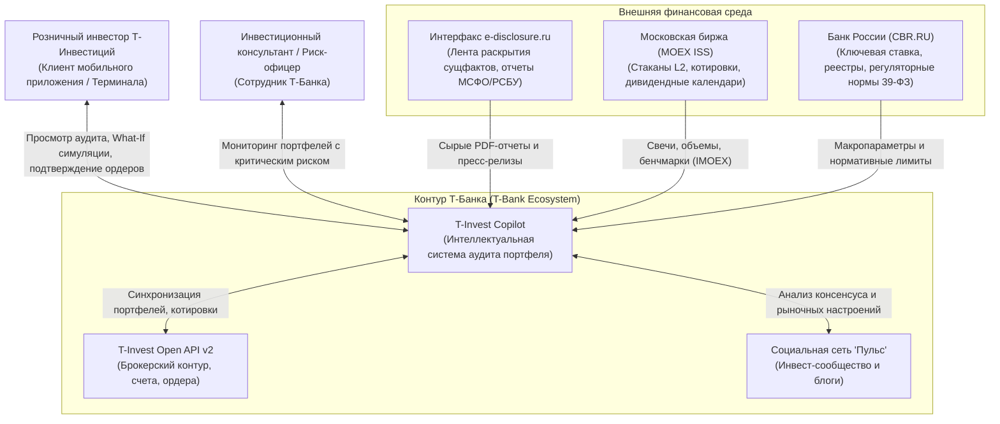
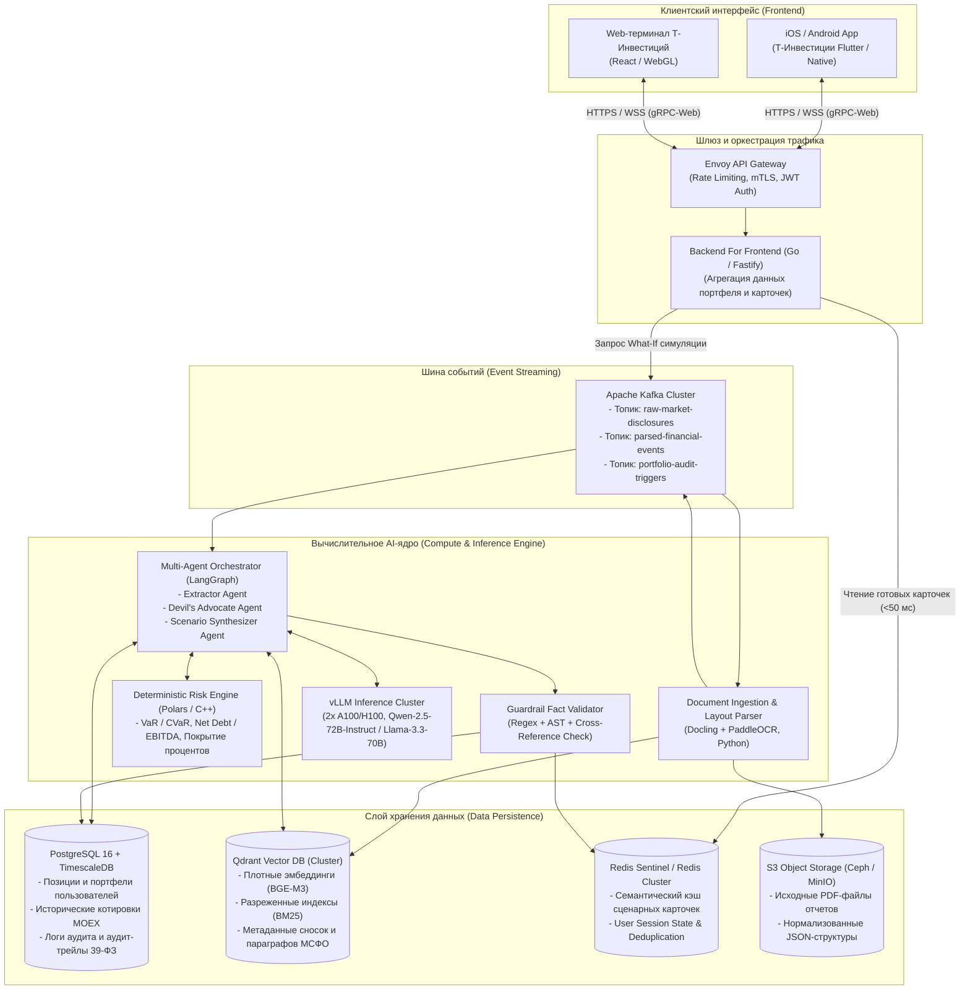

# Системная архитектура: T-Invest Portfolio Health & Narrative Copilot

## 1. Введение и назначение системы
**T-Invest Portfolio Health & Narrative Copilot** — корпоративная AI-платформа институционального уровня для брокера Т-Инвестиции, решающая проблему информационного разрыва и «заброшенных портфелей» у розничных инвесторов на Московской бирже (MOEX).

Система непрерывно отслеживает фундаментальное здоровье активов пользователей, анализирует сырые неструктурированные финансовые отчеты (МСФО/РСБУ) и ленту существенных фактов e-disclosure, сопоставляет их с инвестиционными тезисами клиентов и предоставляет сценарную оценку рисков (Bull / Base / Bear) с жесткой математической защитой от галлюцинаций (Deterministic Guardrails).

---

## 2. Архитектурная модель C4

### Уровень 1: Диаграмма системного контекста (Context Diagram)



---

### Уровень 2: Диаграмма контейнеров (Container Diagram)



---

### Уровень 3: Диаграмма компонентов AI-оркестратора (Component Diagram)

```mermaid
flowchart LR
    subgraph Trigger["Входные триггеры"]
        T1["Event Trigger:<br/>Новый отчет МСФО на e-disclosure"]
        T2["User Trigger:<br/>Открытие портфеля / клик на What-If"]
    end

    subgraph LangGraphWorkflow["Мультиагентный пайплайн (StateGraph)"]
        direction TB
        StateInit["Инициализация состояния портфеля<br/>(PortfolioState)"]
        
        subgraph Stage1["1. Извлечение и расчет"]
            AgentExtract["Extractor Agent:<br/>Семантический RAG-поиск<br/>(долговой профиль, сноски)"]
            EngineMath["Deterministic Risk Engine:<br/>Расчет метрик долга, ликвидности<br/>и дневного VaR (95%)"]
        end

        subgraph Stage2["2. Состязательный синтез"]
            AgentAdvocate["Devil's Advocate Agent:<br/>Поиск триггеров разрушения тезиса<br/>(ковананты, плавающий долг)"]
            AgentSynthesizer["Synthesis Agent:<br/>Формирование сценариев<br/>(Bull / Base / Bear + Альтернативы)"]
        end

        subgraph Stage3["3. Верификация"]
            ValidatorGuard["Guardrail Validator:<br/>Сверка всех чисел с Ground Truth<br/>(100% защита от галлюцинаций)"]
            Fallback["Fallback Router:<br/>Откат к детерминированной<br/>карточке при расхождении"]
        end

        StateInit --> AgentExtract & EngineMath
        AgentExtract & EngineMath --> AgentAdvocate
        AgentAdvocate --> AgentSynthesizer
        AgentSynthesizer --> ValidatorGuard
        ValidatorGuard -->|"Passed"| Output["Готовая карточка аудита"]
        ValidatorGuard -->|"Failed"| Fallback --> Output
    end

    Trigger --> StateInit
```



---

## 3. Спецификация контрактов и схем данных

### 3.1. Protobuf-контракт карточки сценарного аудита (gRPC)

```protobuf
syntax = "proto3";

package tinvest.copilot.v1;

enum HealthStatus {
  HEALTH_STATUS_UNSPECIFIED = 0;
  HEALTH_STATUS_HEALTHY = 1;       // Зеленый: фундаментально устойчив
  HEALTH_STATUS_WARNING = 2;       // Желтый: рост нагрузки, ухудшение показателей
  HEALTH_STATUS_CRITICAL = 3;      // Красный: разрушение тезиса, риск дефолта/размытия
}

message GroundTruthReference {
  string source_document_id = 1;   // Хэш документа в e-disclosure
  string page_number = 2;          // Номер страницы PDF
  string footnote_id = 3;          // Номер примечания к МСФО (e.g. "Note 18")
  string exact_quote = 4;          // Точная цитата первоисточника
}

message ScenarioProjection {
  double target_pnl_pct = 1;       // Ожидаемое изменение цены позиции (%)
  string scenario_thesis = 2;      // Описание драйверов сценария
  double probability_weight = 3;   // Вероятность реализации [0.0 .. 1.0]
}

message ScenarioAuditCard {
  string ticker = 1;
  string isin = 2;
  HealthStatus health_status = 3;
  bool thesis_intact = 4;
  string narrative_summary = 5;    // Синтезированный вердикт
  
  // Детерминированные финансовые метрики
  double net_debt_to_ebitda = 6;
  double interest_coverage_ratio = 7;
  double floating_rate_debt_share = 8;
  double position_var_95_rub = 9;

  // Сценарии
  ScenarioProjection bull_scenario = 10;
  ScenarioProjection base_scenario = 11;
  ScenarioProjection bear_scenario = 12;

  // Защитные альтернативы (инструменты с фиксированной доходностью)
  string defensive_alternative_ticker = 13; // e.g. "LQDT", "SU26238RMFS4"
  string defensive_rationale = 14;

  // Атрибуция достоверности
  bool guardrail_verified = 15;
  repeated GroundTruthReference evidence_sources = 16;
  int64 generated_at_timestamp = 17;
}
```

---

## 4. Бюджет задержек (Latency Budget) и надежность

| Этап конвейера | Допустимое время (SLA) | Механизм оптимизации / Отказоустойчивость |
|---|---|---|
| **Открытие экрана пользователем (Cache Hit)** | $\le \mathbf{45\text{ ms}}$ | Чтение предварительно сгенерированной карточки из Redis Cluster |
| **Семантический поиск (Qdrant)** | $\le \mathbf{60\text{ ms}}$ | HNSW-индекс в оперативной памяти, фильтрация по тикеру и году |
| **Детерминированный риск-расчет** | $\le \mathbf{10\text{ ms}}$ | Векторизованные вычисления на Polars / C-bindings |
| **Генерация LLM (vLLM Engine)** | $\le \mathbf{900\text{ ms}}$ | Speculative decoding, continuous batching, streaming response |
| **Guardrail проверка фактов** | $\le \mathbf{25\text{ ms}}$ | Детерминированное regex-сопоставление множеств чисел с Ground Truth |
| **Полный сквозной цикл (Cache Miss)** | $\le \mathbf{1.2\text{ s}}$ | Асинхронная доставка по SSE/WebSocket с отображением скелетона |

### Стратегия деградации при отказах (Graceful Degradation):
1. **Сбой LLM-кластера:** Система автоматически переключается в чисто детерминированный режим: пользователю выводятся точные коэффициенты (Net Debt/EBITDA, Interest Coverage, VaR) и правила-эвристики без потери качества фактов.
2. **Сбой векторной БД:** Используются закэшированные таблицы отчетности из PostgreSQL без поиска по сложным текстовым сноскам.
3. **Отказ парсера PDF:** Очередь Kafka задерживает сообщения в Dead Letter Queue (DLQ), не блокируя пользовательские сессии.

---

## 5. Соответствие регуляторным требованиям Банка России (39-ФЗ)
- **Исключение признаков индивидуальной инвестиционной рекомендации (ИИР):**  
  Все формулировки генерируются в строгом сценарном сослагательном наклонении (*«При сохранении ставки ЦБ 21% процентные расходы могут снизить свободный денежный поток на...»*).
- **Наличие дисклеймеров и Click-to-Source:**  
  Каждое числовое утверждение снабжено кликабельной сноской на страницу официального аудированного отчета МСФО или ленты e-disclosure.
- **Нейтральность альтернатив:**  
  В качестве альтернатив предлагаются системные защитные бенчмарки (фонды денежного рынка MOEX, государственные ОФЗ-ПК), а не спекулятивные акции с высокой комиссией.
